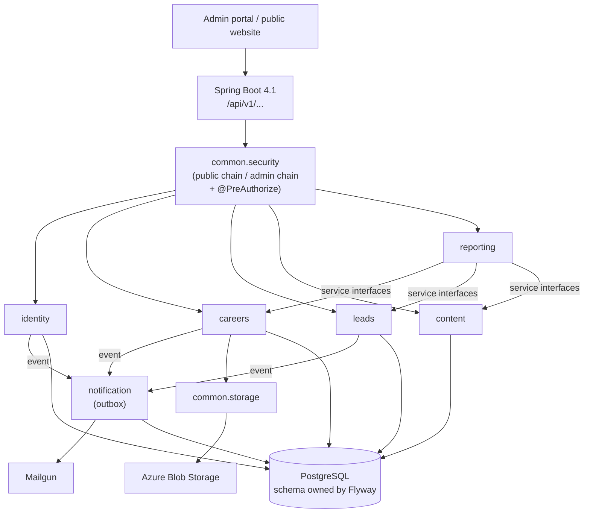

# Architecture Designer: WM-Admin-Portal-BE

Design-time architecture guidance for the WM-Admin-Portal-BE Java 21 / Spring Boot 3.4+ single-tenant modular monolith.
For reviewing an *existing* change's architecture, use the `architecture-reviewer` agent instead.
This skill is for designing something *new* (a module, a package boundary, a cross-cutting
decision) before code exists.

The architecture is **single tenant**: one organisation, one database, one deployable. There is
no tenant dimension to design for. The design questions are about **modules**: what each one
owns, what it exposes, and who may call it.

## Stack at a Glance

- **Stack (checked against `pom.xml`, 2026-11-05):** Java 21, **Spring Boot 4.1.2** (Jakarta EE
  11, Hibernate 7.4, Flyway 12), Maven, PostgreSQL through Spring Data JPA. ADR-008 is the newest
  supported line; check spring.io before each upgrade and follow `dependency-upgrade`.
- Base package `com.wealthmax`, main class `WmAdminPortalApplication`. Target layout
  (`docs/revamp-audit-report.md` section 6.1, ADR-002):
  - `common/`: the shared kernel (`audit`, `config`, `constant`, `dto`, `entity`, `exception`,
    `logging`, `security`, `storage`, `util`). It depends on no module.
  - feature modules: `identity`, `careers`, `leads`, `content`, `reporting`, `notification`.
  - inside each module: `controller`, `dto/request`, `dto/response`, `entity`, `mapper`,
    `repository`, `service`, `service/impl`.
  Today only the main class and an empty `common/` exist. Modules are added one at a time.
- **Reference code:** this repository rewrites the old one (`Wealthmax-Admin-Portal-BE`, package
  `com.wealthmax.adminPortal`), which is retired at the cutover. The old `careers_in` module is the pattern
  source until `careers` is ported here. Port behaviour, never the old flat layers.
- Auth (target, `docs/revamp-audit-report.md` 6.2): stateless JWT, a public and an admin filter
  chain, plus `@EnableMethodSecurity` and `@PreAuthorize` on admin use cases. BCrypt for passwords.
- Schema: **Flyway migrations** are the only way the schema changes. `ddl-auto=validate` and
  `baseline-on-migrate=false`: the database starts empty and the migrations build it. See
  `flyway-migration`.
- Email: Mailgun, through the `notification` module (outbox, sent after commit).
- Files: Azure Blob Storage, through `common.storage`.
- Docs: springdoc OpenAPI (Swagger UI).
- Boundaries: one ArchUnit test, `ModuleBoundaryArchitectureTest`, covers every module (ADR-005).
- Source control: Azure DevOps (`azure-pr`).

Before designing anything that touches an existing area, read `docs/admin-portal-module-documentation.md`
(every module, endpoint and known issue) and, for direction, `docs/revamp-audit-report.md`. The
target layout in the audit report's section 6 is a **proposal**, not an accepted decision. Treat it
as an option until an ADR accepts it.

## When to Use This Skill

- Deciding whether a feature is a new module, or belongs in an existing one
- Setting an inter-module communication pattern
- Porting a feature from the old repository into a module
- Planning for scale inside the modular-monolith constraint (not evaluating microservices; see
  MUST NOT DO)
- Authoring an ADR for a structural decision
- Evaluating a new library or technology

## Core Workflow

1. **Understand requirements.** Read the relevant docs above, the module's plan (for example
   `docs/careers-applicant-in-api.md`), and `.claude/skills/coding-standards/SKILL.md`.
2. **Identify module placement.** A new business capability is a new module. Use
   `modular-monolith` to decide, and don't ask the user if it's obvious.
3. **Design.** Document trade-offs. Produce a Mermaid diagram for anything touching more than one
   module.
4. **Document.** Write an ADR for any decision that changes a module boundary, introduces a new
   cross-cutting pattern, or adds a dependency (see ADR section). "Which package does this CRUD
   feature live in" does not need an ADR. Save those for choices with real trade-offs.
5. **Review.** Check against the layering and boundary rules below.

## Constraints

### MUST DO
- Follow layering inside a module: `entity` → `repository` → `service` (interface) →
  `service.impl` → `controller`. Dependencies point inward, never from a lower layer to a
  higher one.
- Give each module **one owner** for each table, and expose only service interfaces, DTOs and
  enums.
- Put code used by two or more modules in `common`. Never import a sibling module's internals.
- Decide Public, Authenticated or Admin for every new endpoint, and write the
  `SecurityConfiguration` rule. A public rule is explicit and commented.
- Plan any schema change as a Flyway migration (see `flyway-migration`), written before the
  entity that depends on it.
- Keep `ModuleBoundaryArchitectureTest` passing. It covers a new module without changes.
- Write an ADR (`docs/adr/`) for structural decisions.

### MUST NOT DO
- Reach into another module's `entity`, `repository`, `mapper` or `service.impl` packages. Cross
  module calls go through the other module's **service interface**, DTOs, enums or events. Use an
  event when the caller shouldn't wait for, or depend on, the result (emails are the typical
  case).
- Make `common` depend on a feature module.
- Create a JPA relationship, join or foreign-key mapping across modules.
- Design for microservice-scale hypotheticals. This is a modular monolith by deliberate choice.
  Don't propose extraction without a concrete scaling trigger.
- Add anything tenant-shaped: a tenant column, a tenant context, a tenant filter, tenant-based
  routing. There is one tenant.
- Put business logic in a controller, or return an entity from one.

## Output Template

When designing architecture, provide:
1. Requirements summary (functional and non-functional)
2. Module placement and layer breakdown
3. Mermaid diagram (module topology, or a sequence diagram for a cross-module flow)
4. Key decisions with trade-offs. Promote to a full ADR if the decision is structural
5. Access level per endpoint (Public, Authenticated, Admin)
6. Data ownership: tables per module
7. Risks and mitigations

### Architecture Diagram (Mermaid, target module topology)



## Architecture Decision Records (ADRs)

ADRs record **why a structural choice was made**, separate from a plan or patch summary, which
records **what shipped**. Write one when a decision changes a module boundary, picks between real
architectural alternatives, or adds a new external dependency or pattern. Routine feature work
doesn't need one.

- **Location:** `docs/adr/ADR-{NNN}-{kebab-title}.md` (zero-padded 3-digit number). The folder
  doesn't exist yet. Create it with the first ADR.
- **Numbering:** next sequential number. Check `docs/adr/` for the highest existing one first.
- **Template:** `.claude/skills/architecture-designer/references/adr-template.md`
- **Status values:** Proposed → Accepted → (later) Deprecated / Superseded by ADR-XXX

The ADR register in `docs/revamp-audit-report.md` section 6.6 lists ADR-001 to ADR-009 with their
status. Two are already **Accepted** (2026-11-05): ADR-005 boundary enforcement by **ArchUnit**
(Spring Modulith was considered and not chosen) and ADR-008 the **Java 21 / Spring Boot 3.4+**
runtime target. Still **Proposed**: ADR-001 modular monolith / single tenant, ADR-002 the target layout
(this repository's `com.wealthmax` layout with the careers_in layers), ADR-003 the careers UK/IN
merge, ADR-004 Flyway from V1 on a new database (already configured that way here), ADR-006 the
notification outbox mechanism, ADR-007 test infrastructure, and ADR-009 the delivery approach (new
repository, new database, one rehearsed cutover). Write the ADR before implementation starts on
anything it governs; read section 6.6 for the reasoning to carry across.

### Worked example

```markdown
# ADR-001: Modular Monolith, Single Tenant

## Status
Proposed

## Context
WM-Admin-Portal-BE is the back end of the Wealthmax admin portal and its public website
forms. It serves one organisation, with one database and one auth subsystem. It is being
rewritten as modules from the start, replacing the old repository's flat layers. The team is small
and values iteration speed over independent deployment.

## Decision
Modular monolith. Each business capability is a package under `com.wealthmax` that
owns its endpoints, logic and tables. Modules talk through each other's service interfaces, DTOs
and application events, never through entities or repositories. `common` holds shared kernel code
and depends on no module. The application is single tenant: no tenant column, context or filter.

## Consequences
**Positive:** one deployable, easy local debugging, simple transactions, a clear place for every
class, and a path to extract a module later if a real trigger appears.
**Negative:** the compiler doesn't enforce module boundaries, so `ModuleBoundaryArchitectureTest` (ArchUnit)
does; one module's bug can still bring the process down; every feature from the old repository has
to be ported module by module.

## Alternatives Considered
**Microservices:** rejected. No scaling reason, and it would add network calls, distributed
transactions and deployment overhead for no present benefit.
**Stay flat:** rejected. Without boundaries the flat layers couple every feature to every other,
which is the problem the audit report describes.

## References
- `docs/admin-portal-module-documentation.md`
- `docs/revamp-audit-report.md`, section 6
- `src/test/java/com/wealthmax/ModuleBoundaryArchitectureTest.java`
```

## Reference Guide

| Topic | Where | Load when |
|---|---|---|
| Module rules, boundaries, data ownership | `.claude/skills/modular-monolith/SKILL.md` | Any design |
| What exists today, every endpoint | `docs/admin-portal-module-documentation.md` | Touching an existing area |
| Known problems and the revamp plan | `docs/revamp-audit-report.md` | Planning direction |
| Naming, entity, exception conventions | `.claude/skills/coding-standards/SKILL.md` | Designing any class |
| Endpoint-level design | `.claude/skills/api-designer/SKILL.md` | Once module placement is settled |
| Schema changes | `.claude/skills/flyway-migration/SKILL.md` | New table or column |
| ADR template | `references/adr-template.md` | Writing an ADR |
