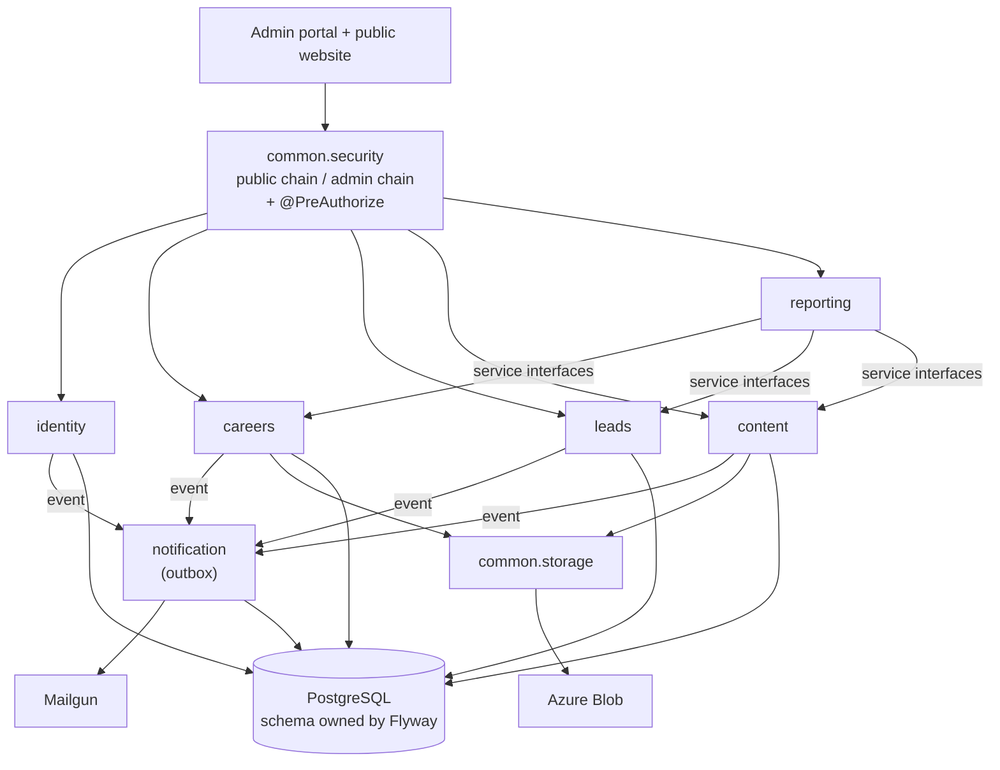

# Admin Portal Backend: Pre-Revamp Audit Report

| | |
| --- | --- |
| Code audited | branch `sarthak`, commit `e9c7775` (working tree; `src/main` unchanged from that commit) |
| Date | 2026-11-02 |
| Scope | All of `src/main` and `pom.xml`. `src/test` was only inventoried. |
| Mode | Read-only. Only `git`, `grep` and `javap` on existing `target/classes` were run. No tests, no application start, no database connection. |
| Secrets | No credential, key or code value appears in this report. Properties and constants are named with `file:line` only. |

Paths are relative to `src/main/java/com/wealthmax/adminPortal/` unless they start with `resources/`, `pom.xml` or `docs/`.

**Labels**

- **Confirmed:** read in the code, or shown by `git` or `javap`.
- **Suspected:** inferred but not executed. Each one says what would confirm it.
- No HTTP request was sent, so no exploit was run end to end.

---

## Table of Contents

1. [Executive Summary](#1-executive-summary)
2. [Findings Table](#2-findings-table)
3. [DTO Matrix (all 107 endpoints)](#3-dto-matrix-all-107-endpoints)
4. [SOLID Table](#4-solid-table)
5. [Status of the Known Issues in the Module Documentation](#5-status-of-the-known-issues-in-the-module-documentation)
6. [Revamp Recommendations](#6-revamp-recommendations)
7. [Method, Coverage and Gaps](#7-method-coverage-and-gaps)

---

## 1. Executive Summary

The backend cannot be made safe by patching. Three things are wrong at the base:

- **Authorization.** Routes are open by default and only a few are protected.
- **Authentication.** Several independent ways exist to get an ADMIN token without the admin's password.
- **Change process.** There are no schema migrations, no shared conventions and almost no tests.

The careers_in module shows the right direction, with request/response DTOs, paging, a DB sequence, HTML escaping and tests. It still inherits the same security model and error handling.

### Counts

89 findings, plus one "verified not an issue" entry (SEC-36).

| Category | Critical | High | Medium | Low | Total |
| --- | --- | --- | --- | --- | --- |
| Security (SEC) | 8 | 9 | 14 | 4 | 35 |
| DTO discipline (DTO) | 0 | 1 | 10 | 4 | 15 |
| SOLID / design (SOL) | 0 | 1 | 8 | 2 | 11 |
| Other (OTH) | 0 | 7 | 17 | 4 | 28 |
| **Total** | **8** | **18** | **49** | **14** | **89** |

DTO matrix: 107 endpoints, 94 with at least one violation, 13 OK (careers_in: 3 of 11; v1: 10 of 96).

### The 10 worst problems

| # | ID | Problem | What an attacker or failure does |
| --- | --- | --- | --- |
| 1 | SEC-04 | Sign-in looks up the OTP by its value only. It never checks that the OTP belongs to the email in the request. | Anyone can self-register, request their own OTP, then sign in as **any** email, including an ADMIN. No admin password is needed. |
| 2 | SEC-02, SEC-03 | `POST /api/v1/admin` and `PUT /api/v1/user/update/{id}` are public. Both accept `role` (and update also accepts `email`) from the client. | An anonymous caller can create an ADMIN or promote any user. Changing a victim's email to the attacker's, then calling forgot-password, takes over the account. |
| 3 | SEC-05 | A hard-coded master OTP constant signs in any ADMIN email. | Anyone who has seen the source (or its Git history) can sign in as any admin. |
| 4 | SEC-06 | The JWT HMAC key is a string literal in source and has not changed since the first commit. | Anyone with repository access can forge a token for any user, offline. |
| 5 | SEC-07 | The database password, Azure storage connection string (with account key), Mailgun and SendGrid keys are in the tracked `application.properties`. They are in all 11 historical versions. | Repository access gives full control of the storage account, the mail domain and the database. Rotation is required, not only removal. |
| 6 | SEC-01, SEC-08, SEC-09 | 19 of the 22 controller roots are `permitAll`, including writes and deletes. | Anonymous callers can list, download and delete every resume in Blob storage, export all leads to Excel, read applicant and subscriber PII, and wipe all leads with one `DELETE /AppointedRepresentative/deleteAll`. |
| 7 | SEC-10 | Public forgot-password replaces the password immediately and emails the new one in plain text. | Anyone can lock out any user, including admins, repeatedly. If Mailgun fails, the password is already changed and the user can't log in. |
| 8 | SEC-16 | Public image upload writes to disk using the client's file name, and serves back the client's content type. | Suspected arbitrary file write outside the image folder. Stored XSS by uploading HTML or SVG that the API origin then serves. |
| 9 | DTO-01 | Create endpoints copy the client's `id` into a new entity and call `save()`, which merges onto the existing row. | On public routes, anyone can overwrite any existing record by id. |
| 10 | OTH-01 | No schema migrations. `ddl-auto=update` plus `schema.sql` run on every start. | Renames and dropped constraints from recent commits never reach existing databases. Every environment drifts. |

---

## 2. Findings Table

Effort: **S** is under a day, **M** is days, **L** is a week or more (in the rewrite, or as a stop-gap where noted).

### 2.1 Security (mapped to OWASP Top 10 2021)

> **Scope rule (2026-11-04, replaces the earlier note that listed seven findings):** all code enhancement is done by this team. The only thing the DevOps team handles is the **secrets in `application.properties`** (SEC-07: database password, storage connection string, mail API keys, and the other credential values in that file). This team does not touch those secret values: no rotating, moving or removing them. SEC-07 stays in the table as a finding. References to SEC-07 elsewhere in this report (worst-problems #5, S6, the Phase 0 credential rotation) follow the same rule.
>
> SEC-27, SEC-28, SEC-30, SEC-31, SEC-33 and SEC-34 are code or build changes, so they are **in scope for this team**. The JWT key (SEC-06) is a literal in Java source, not in `application.properties`, so it is also in scope: the code stops hard-coding it and reads it from configuration, and DevOps supplies the value.

| ID | Sev | OWASP | Location | Evidence | Impact (what an attacker can do) | Recommended fix | Effort |
| --- | --- | --- | --- | --- | --- | --- | --- |
| SEC-01 | Critical | A01 Broken Access Control | `config/SecurityConfiguration.java:36-65` | Open by default. 19 controller roots are `permitAll` for every method: author, careers v1, otp, image, admin, roles-access, user, AppointedRepresentative, page-header, adviser, team-members, applicant v1, newsletters, blob, departments, homepagecount, export, ExcelData, auth. Only `/applicant/IN/**`, `/careers/IN/**` (:48, any role) and `/referral/**` (:77, `ADMIN`) are protected. There is no method security anywhere (no `@EnableMethodSecurity`, `@PreAuthorize` or `@Secured`). | Unauthenticated create, update and delete on almost every resource. | Deny by default: `anyRequest().authenticated()`, plus an explicit public allow-list of the website calls. Role or permission checks on every admin route, plus `@PreAuthorize` on services. | M |
| SEC-02 | Critical | A01 / A04 | `controller/AdminController.java:33-37`; `service/impl/UserServiceImpl.java:173-191` (role at :185); rule `SecurityConfiguration.java:52` | `POST /api/v1/admin` is public and creates a user with a client-chosen role and password. `GET /api/v1/admin` (:28-31) lists every user's id, name, email and role. | An anonymous caller creates an ADMIN with a mailbox they own. The OTP then goes to that mailbox, giving a full admin session. All admin emails can be enumerated. | User management becomes admin-only. Roles are never accepted from an unauthenticated or self-service request. Role changes are audited. | S |
| SEC-03 | Critical | A01 | `controller/UserController.java:40-43`; `service/impl/UserServiceImpl.java:93-105` (email :98, role :99); rule :54; `entity/User.java:34` | `PUT /api/v1/user/update/{id}` is public, has no `@Valid` and no ownership check, and overwrites email, role, names and country. If `role` is omitted, `null` is stored. `getAuthorities()` then throws a `NullPointerException` for that user on every request. | Promote any sequential id to ADMIN. Take over an account: set its email to the attacker's, then call forgot-password (SEC-10). Permanently break any account by sending no role. | Self-service profile goes on `/me`, taken from the token. Admin edits use a DTO with no role field. A separate audited role endpoint. | S |
| SEC-04 | Critical | A07 Identification and Authentication Failures | `service/impl/AuthenticationServiceImpl.java:89-103`; `repository/OtpRepository.java:12` | `findByOtp(otp)` searches all OTP rows. The user is then loaded from the **request** email (:100); the OTP row's own email is never compared. The row is not deleted after use. | Sign up (public, `AuthenticationController.java:34`). Call `sendOtp` with your own credentials. Call `signin` with the victim's or an admin's email and your OTP. You receive a 24-hour access token and a 7-day refresh token for the victim. Alternatively, brute-force the 4-digit space against any live OTP (no attempt limit, SEC-13). | Login as a challenge: step 1 checks the password and returns a `challengeId`. Step 2 takes `{challengeId, code}`, checks against that challenge only, counts attempts, and marks it used. | M |
| SEC-05 | Critical | A07 / CWE-798 | `service/impl/AuthenticationServiceImpl.java:34` (constant `ADMIN_MASTER_OTP`), :81-87 | A fixed code returns a full token pair for any user with role ADMIN, skipping both the password and the OTP. | Anyone who has seen the source or its Git history signs in as any admin. Combined with SEC-02 or SEC-03, they can also choose which account is an admin. | Delete it. Treat the value as burned. If break-glass access is needed, make it out-of-band, time-boxed and audited. | S |
| SEC-06 | Critical | A02 Cryptographic Failures | `service/impl/JwtServiceImpl.java:50-54` (literal at :51) | HS256 key decoded from a string literal on every call. Unchanged since the first commit `caf1d5d`. Tokens carry only `sub`, `iat` and `exp`; roles come from the database, so forging `sub` is enough. | Anyone with repository access, now or in the past, can mint a valid token for any email. | Key comes from a secret store (env or Key Vault), at least 256 random bits, with a `kid` for rotation. Better: an asymmetric key (RS256/ES256) with Spring's resource-server support. Rotate now, which invalidates all tokens. | S |
| SEC-07 | Critical | A02 / A05 Security Misconfiguration | `resources/application.properties:6` (`spring.datasource.password`), :15 (`spring.sendgrid.api-key`), :19 (`spring.security.user.password`), :40 (`spring.cloud.azure.storage.blob.connection-string`), :44 (`mailgun.api.key`) | The file is tracked (`git ls-files`). 11 commits touch it, and the secret-bearing keys exist in every version (2 to 4 of them per commit). There are no `${...}` placeholders and no profile files. | Repository access gives full control of the storage account (resumes), the ability to send mail as the company, and database access. | **Rotate every credential.** Use env vars or Key Vault, with profile files that hold placeholders only. Add secret scanning (for example gitleaks) to pre-commit and CI. Decide whether to purge history (rotation is required either way). | S (rotate) / M (externalise) |
| SEC-08 | Critical | A01 | `controller/MyBlobRestController.java:34-81`; `service/MyBlobService.java`; rule `SecurityConfiguration.java:61` | `GET /api/v1/blob/` lists every blob name. `GET /download/{filename}` and `POST /download/bulk` return any blob. `POST /upload` accepts any file. `DELETE /blob/{blobName}` deletes any blob. All are anonymous. Applicant resumes are stored here. | Download every candidate's CV, delete them, or host arbitrary files on the company's storage. | Private container. Uploads through a server-issued, per-application token or short-lived write SAS. Downloads admin-only, through short-lived read SAS. No listing endpoint. | M |
| SEC-09 | High | A01 | Rules `SecurityConfiguration.java:52,54,55,59,60,64,65`; `controller/AppointedRepresentative.java:59-61`; `controller/ExcelExportController.java:23`; `controller/NewsletterController.java:81-83,102-105`; `controller/ApplicantController.java:51-58` | Anonymous PII read and delete: v1 applicants (list and delete), every lead (list, by category, dashboards, `deleteAll`), newsletter subscriber emails, reply emails, Excel export of leads by category, and the user list. | Bulk PII exfiltration (UK GDPR breach). `DELETE /AppointedRepresentative/deleteAll` wipes all leads in one call, with no backup. | Admin-only, plus an audit log of PII reads and deletes. Remove `deleteAll`. Soft delete or archive with a retention policy. | S (lock) / M (audit) |
| SEC-10 | High | A07 | `controller/UserController.java:51-55`; `service/impl/UserServiceImpl.java:131-146`; rule :54 | `PUT /api/v1/user/forgetpassword/{EmailId}` is public. It replaces the password at :136-137 before any proof of mailbox ownership, then emails the new password in plain text (:143). An unknown email returns "No user found with email id: ..." (:133). | Lock any user, including admins, out repeatedly. Enumerate accounts. If Mailgun fails, the password has already changed and the user is stranded (OTH-04). | Token flow: store a hashed, single-use, roughly 30-minute token and email a link. Change the password only when the link is redeemed. Same response whether or not the email exists. Rate-limit. | M |
| SEC-11 | High | A07 | `service/impl/JwtServiceImpl.java:25-39`; `config/JwtAuthenticationFilter.java:43-61`; `service/impl/AuthenticationServiceImpl.java:124-152`; `controller/AuthenticationController.java:49-55` | Access token lasts 24 hours and refresh token 7 days. Both use the same key and claims, with no `typ` or `jti`. The filter accepts a refresh token as a bearer token. `refresh-token` accepts an access token and hands back the token it was given as the "refresh token" (:133). `signout` revokes nothing. Password or role changes do not invalidate tokens. | One stolen token can be renewed indefinitely and can't be revoked. Logout is cosmetic. | Short access token (10-15 minutes) with `typ=access`. Opaque refresh token stored hashed, rotated on every use, with reuse detection that revokes the family. Logout revokes the family. A per-user token version, bumped on password or role change. | M |
| SEC-12 | High | A02 / A07 / A09 | `utils/AppUtils.java:7,17-25`; `entity/Otp.java:22`; `service/impl/OtpService.java:53-58,94-114` | OTP is 4 digits from a static `java.util.Random`. It is stored in plain text, never consumed after use, and logged at INFO **before** the password is checked (:58). Existing OTP rows are deleted before authentication (:53-56), so anyone can cancel another user's pending OTP. `POST /otp/validateOtp` is a public oracle that says whether a code is live. | Predictable and brute-forceable codes. Anyone with log access can sign in. Login denial of service. | 6 digits from `SecureRandom`, stored hashed, bound to a challenge, single use, at most 5 attempts, about 5 minutes to live. Never logged. Remove the public validate endpoint. | S |
| SEC-13 | High | A07 / A04 Insecure Design | `pom.xml` (no rate-limit library); `entity/User.java:48-50` (`isAccountNonLocked` always `true`) | No throttling or lockout on signin, sendOtp, validateOtp, change-password, signup or the public forms. | Brute-force OTPs (10^4 codes) and passwords. Mass sign-ups. Spam the public forms. | Bucket4j (or a gateway) limits per IP and per account. Per-challenge attempt caps. Progressive lockout. CAPTCHA on public forms. | M |
| SEC-14 | High | A01 | `SecurityConfiguration.java:40,48`; `service/impl/AuthenticationServiceImpl.java:53-71` | The IN admin routes require only `.authenticated()`, which any role satisfies. `POST /auth/signup` is public and creates `Role.USER` without email verification. | Any self-registered user can create, edit and delete IN jobs, and read or delete IN applicant PII (`ApplicantINController.java:42-57`, `CareersINController.java:44-82`). | Remove public signup from an admin portal (accounts are admin-provisioned). Require an `HR` or `ADMIN` permission on IN admin routes. | S |
| SEC-15 | High | A01 | `controller/ApplicantINController.java:42-57`; `controller/ApplicantController.java:46-58` | Applicant ids are sequential `Long`. There is no per-record authorization and no audit trail. | Combined with SEC-14 (IN) or SEC-01 (v1), every applicant record can be enumerated and deleted. | Admin permission, audit log, and opaque public identifiers if ids are ever exposed. | S |
| SEC-16 | High | A03 Injection / A04 | `service/impl/ImageServiceImpl.java:43-59`; `controller/ImageController.java:43-65`; rule `SecurityConfiguration.java:51`; `resources/application.properties:23` (`project.image`) | `path + File.separator + file.getOriginalFilename()`, then `Files.copy`, with no normalisation or containment check. The client's `Content-Type` is stored (:57) and served back on public `GET /image/image/{id}` (:60-62). The target folder is inside the source tree. The response and delete errors expose the server path (:61, :83). | **Suspected** (not executed): an anonymous caller writes new files outside the image folder. **Confirmed by code:** upload HTML or SVG with a matching content type and the API origin serves it back (stored XSS or phishing page). | Server-generated names (UUID plus an allow-listed extension), magic-byte check, type derived on the server, `Content-Disposition` and `nosniff` headers. Move images to Blob storage and remove disk storage. | S |
| SEC-17 | High | A03 | `service/impl/CreateEmailTemplateImpl.java:49,65,80,96,112,131,147,167,192` | All 9 v1 template builders call `replace("{{key}}", value)` without escaping. Values come from public forms (lead names, contact numbers, products, job titles, referral names). The referral email goes to a caller-supplied address (`ReferralServiceImpl.java:113`). careers_in escapes correctly (`ApplicantINServiceImpl.java:168-175`). | Inject HTML or links into staff inbox emails. Send attacker-controlled HTML to any address from the company's own Mailgun domain (phishing). | One template renderer that escapes by default (Thymeleaf `th:text`, or `HtmlUtils.htmlEscape` as careers_in does). Fail on unresolved placeholders. | S |
| SEC-18 | Medium | A04 | `service/impl/MailgunServiceImpl.java:45,73,113`; `controller/AppointedRepresentative.java:38-41`; `controller/NewsletterController.java:76-78` | A client `emailId` goes straight into Mailgun's `to` field. The lead and subscriber DTOs have no `@Email` and no `@Valid`. | **Suspected:** a comma-separated list turns the public forms into an open mailer from the company domain. Not confirmed, because Mailgun's handling of the list was not tested. | `@Valid @Email`, a single address, reject `,` `;` CR and LF, cap sends per IP. | S |
| SEC-19 | Medium | A04 | `controller/ApplicantINController.java:36-40`; `careers_in/applicant/service/impl/ApplicantINServiceImpl.java:79-104` | The public apply form has no rate limit, no CAPTCHA and no `@Size` on text or lists. Each call writes a row and sends two emails, one of them to the address in the body. The cooldown key is raw `email + mobile`, so `+91` versus no prefix, spaces, or plus-addressing bypass it. | Unlimited rows. Mail sent to any victim address. The leads inbox floods. | Normalise the identity (lowercase email, E.164 mobile). Rate limit plus CAPTCHA. Size caps. | S |
| SEC-20 | Medium | A04 | `service/MyBlobService.java:90-108`; `dto/FileDownloadRequest.java` | Bulk download takes an unbounded list of names and holds every blob in memory three times (download buffer, ZIP buffer, final byte array). A `null` list throws a `NullPointerException`. | Anonymous heap exhaustion (memory, not a decompression bomb). | Cap the count and total bytes. Stream with `StreamingResponseBody`. Admin only. | M |
| SEC-21 | Medium | A01 | `careers_in/careers/service/impl/CareersINServiceImpl.java:65-80,115-121`; `SecurityConfiguration.java:46-47`; `service/impl/NewsletterServiceImpl.java:180,218-237`; `repository/NewsletterRepository.java:14,17,21` | Public IN job reads return INACTIVE jobs three ways: `getAll` has no status filter, `get/{id}` has no check, and `get/status/INACTIVE` is public. Newsletter reads by id, slug and category ignore `status`, so drafts are public. | Unpublished jobs and articles are disclosed. | Separate public read models that only serve ACTIVE or PUBLISHED content. Admin read models are separate. | S |
| SEC-22 | Medium | A04 | `careers_in/applicant/dto/request/ApplicantPersonalDetailsRequestDto.java:48-51`; `careers_in/applicant/mapper/ApplicantDetailsMapper.java:48-49` | `resumeFileName` and `coverLetterFileName` are free strings. They are not checked for existence, format or ownership. Blob names are listable (SEC-08). | Attach another person's resume to a fake application. Admins see the wrong CV. | A server-issued upload reference bound to the application, checked at submit. | S |
| SEC-23 | Medium | A07 | `config/JwtAuthenticationFilter.java:44,47,49`; `SecurityConfiguration.java:33-84` | `extractUsername`, `loadUserByUsername` and `isTokenValid` are not wrapped in try/catch. There is no `AuthenticationEntryPoint` or `AccessDeniedHandler`. | An expired or malformed token breaks the request even on public routes (including `/auth/signin`), with a non-standard body. Unauthenticated calls to protected routes return 403 instead of 401 (**suspected**: exact status not exercised). | Catch `JwtException` and continue as anonymous. JSON 401 and 403 handlers that return the standard error body. | S |
| SEC-24 | Medium | A04 | `repository/UserRepository.java:11,13`; `entity/User.java:24`; `service/impl/AuthenticationServiceImpl.java:73-76` | The duplicate check `existsByEmail` is case-sensitive, and so is the unique constraint. Every login path uses `findByEmailIgnoreCase`, which returns a single `Optional`. | Registering `Admin@x` next to `admin@x` makes every later lookup throw `IncorrectResultSizeDataAccessException`. That user can't log in or reset their password (**derived from code**, not run). | Lowercase emails on write. Unique index on `lower(email)`. | S |
| SEC-25 | Medium | A07 | `service/impl/AuthenticationServiceImpl.java:75,84,91,101`; `service/impl/UserServiceImpl.java:133` | Different messages for "email exists", "email invalid", "OTP invalid" and "no user with email". `sendOtp` is uniform (good). | Account enumeration. | Same response for every outcome on public flows. | S |
| SEC-26 | Medium | A07 | `controller/UserController.java:45-49`; `service/impl/UserServiceImpl.java:107-121`; `dto/PasswordDto.java` | `PUT /user/update/password/{userid}` is public, keyed by a sequential id, and checks the old password with no throttling. The new password has no policy. | A password-guessing oracle for every account. | Authenticated `/me/password` with a password policy, lockout, and token revocation after the change. | S |
| SEC-27 | Medium | A02 | `config/ApplicationConfig.java:18-20` (BCrypt cost 8); `config/SecurityConfiguration.java:94-97` (cost 10); `service/impl/UserServiceImpl.java:117,136` (`new BCryptPasswordEncoder()`), :187 (cost 8); `dto/SignupRequest.java:19`, `dto/UserCreateRequestDto.java:27` | Two encoder beans with different costs. Admin-created users get cost 8. The only password policy is `@NotBlank`. | Weaker hashes for admin accounts. Trivial passwords accepted. | One `PasswordEncoder` bean (BCrypt 12 or Argon2, via `DelegatingPasswordEncoder` for migration). Length and breached-password policy. | S |
| SEC-28 | Medium | A05 | `SecurityConfiguration.java:36-39`; `config/SwaggerConfig.java:27-28`; `resources/application.properties:31-32` | Swagger UI and `/v3/api-docs` are public in every environment, including a "Production" server entry. | Full API map for attackers. | Profile-gate springdoc (off in prod) or require admin. | S |
| SEC-29 | Medium | A09 Security Logging and Monitoring Failures | `service/impl/OtpService.java:58,73`; `service/impl/UserServiceImpl.java:138`; `common/exception/GlobalExceptionHandler.java:65-66`; `controller/MyBlobRestController.java:69-71`; `service/impl/EmailServiceImpl.java:34,64`; `common/config/RequestLoggingFilter.java:15` | OTP in plain text. Emails at INFO. Postgres constraint detail (contains the duplicate value) at WARN. Client file names concatenated into log lines (log forging). The dead SendGrid path logs full email bodies. The request log runs after the security chain, so 401/403 responses are never logged (0 of 512 local request lines). No login-failure or admin-action audit trail. | Credentials and PII in logs. Attacks are invisible. | Security audit events (login success and failure, role changes, PII reads and deletes). Masking. Request-log filter ordered before security, with MDC `traceId`. | M |
| SEC-30 | Medium | A06 Vulnerable and Outdated Components | `pom.xml:8` (Boot 3.2.5), :95-99 (`commons-fileupload` 1.4), :119-123 (POI 5.2.5), :44-48 (sendgrid-java 4.1.2), :31-35 (modelmapper 2.4.4), :109-113 (`azure-spring-boot-starter-storage` 4.0.0), :85-104 (JJWT 0.11.5) | Spring Boot 3.2.x is out of open-source support. `commons-fileupload` 1.4 is affected by CVE-2023-24998 and is not imported anywhere. The rest are **suspected**: run OWASP dependency-check, which was not run here. JJWT 0.11.5 has no CVE I'm confident about but uses deprecated APIs. | Known framework CVEs remain unpatched. | Target Boot 3.4+ and Java 21. Remove unused dependencies (commons-fileupload, commons-io, SendGrid, the Azure starter). Run dependency-check in CI. | S |
| SEC-31 | Low | A05 | `config/ApplicationConfig.java:22-44`; `@CrossOrigin("*")` on 21 controllers (for example `controller/AdminController.java:19`) | A credentialed CORS filter allows prod, stage and localhost origins together. One origin has a trailing slash (:37), so it never matches. The per-controller `@CrossOrigin("*")` contradicts the filter (**suspected** to have no effect, because the filter runs first). CSRF is disabled (:34); that is acceptable for a bearer-only API. | Localhost origins are trusted in production. The config is misleading. | One property-driven `CorsConfigurationSource` per profile. Remove `@CrossOrigin`. | S |
| SEC-32 | Low | A03 | `controller/ExcelExportController.java:28`; `controller/MyBlobRestController.java:44` | Path variables are concatenated into an unquoted `Content-Disposition` filename. | Header parameter injection, and odd downloads. | `ContentDisposition.attachment().filename(..)`. Validate category against an enum. | S |
| SEC-33 | Low | A05 | `common/exception/GlobalExceptionHandler.java:55-59`; `service/impl/ImageServiceImpl.java:61,83` | Every `IllegalArgumentException` message, including library ones such as ModelMapper's and JJWT's, is returned to the client as a 400. Image upload and delete reveal absolute server paths. | Information leak. Server bugs are reported as client errors. | Domain exceptions only. Unknown exceptions return a 500 with a generic body. | S |
| SEC-34 | Low | A04 | `entity/User.java:28` | `Role role` has no `@Enumerated`, so it is stored as an ordinal (USER=0, ADMIN=1), and it is nullable. | Reordering the enum silently swaps privileges. | `@Enumerated(STRING)`, not null, with a data migration. | S |
| SEC-35 | Medium | A04 | `controller/MyBlobRestController.java:67-76`; `service/MyBlobService.java:63-74` | Blob upload checks no extension, content type or emptiness (only the global 10 MB limit). The name is `Instant.now() + originalFilename` (`null` gives a `NullPointerException`). If the name already exists, nothing is stored but "success" is returned. | Arbitrary file hosting. Lost uploads that report success. | Allow-list (pdf, doc, docx) plus a magic-byte check. UUID names. Throw on collision. | S |
| SEC-36 | Info | n/a | n/a | **Checked and not found:** see the list below. | n/a | Keep these properties in the rewrite. | n/a |

**SEC-36 details: checked and not found.**

- **SQL or JPQL injection.** Every `@Query` is parameterised. `SearchSpecifications` takes attribute names from constants and escapes LIKE wildcards (`careers_in/common/search/SearchSpecifications.java:19,72-74`).
- **Excel formula injection.** `ExcelExportService.java:55-61` writes typed string cells, which Excel doesn't evaluate.
- **Inbound ZIP or Excel parsing.** None, so no XXE or decompression-bomb risk.
- **SSRF.** No client-supplied URL is fetched. The Mailgun URL comes from config.
- **Actuator.** Defaults to `health` only, behind `anyRequest().authenticated()`.
- **`alg:none` tokens.** Rejected by `parseClaimsJws`.
- **Email header injection.** Subjects are constants and Mailgun is called with form fields.
- **Stack traces in error bodies.** None; Boot defaults are unchanged.

### 2.2 DTO discipline

The per-endpoint detail is in [section 3](#3-dto-matrix-all-107-endpoints).

| ID | Sev | Location | Evidence | Impact | Recommended fix | Effort |
| --- | --- | --- | --- | --- | --- | --- |
| DTO-01 | High | Creates: `service/impl/PageHeaderServiceImpl.java:47-48`, `TeamServiceImpl.java:47-48`, `AdviserServiceImpl.java:54`, `ApplicantServiceImpl.java:69-70`, `AppointedRepresentativeServiceImpl.java:81`, `CareersServiceImpl.java:63`, `HomePageCountServiceImpl.java:40-41`, `RolesAndAccessServiceImpl.java:48-52`, `ExcelDataServiceImpl.java:53-54`, `NewsletterServiceImpl.java:302-303,358-359` | 19 v1 endpoints use one DTO for request and response. It carries `id` (for example `dto/PageHeaderDto.java:12`), and in places `status`, `jobId`, `datePosted` (`CareersServiceImpl.java:115-120`), `role` (`dto/UserDto.java:20`) and audit fields. ModelMapper copies `id` into a new entity, and `save()` then **merges** onto the existing row. | On public routes, anyone can overwrite any existing row by id. `RolesAndAccess` save can also un-delete and bypass the duplicate check. | Separate `XCreateRequest`, `XUpdateRequest` and `XResponse` records. Request records never contain id, status, audit or business-number fields. | M |
| DTO-02 | Medium | `utils/CommonDateTimeReq.java:13-15`; extended by `dto/AdviserDto.java:12`, `AppointedRepresentativeDto.java:20`, `ImageDto.java:12`, `NewsletterDto.java:12`, `PageHeaderDto.java:11`, `ReferralDto.java:18`, `TeamDto.java:11` | A JPA `@MappedSuperclass` (with `@Data`) is the base of 7 DTOs, and 5 of them are request bodies, so clients can send `createdAt` and `updatedAt`. | Audit fields are writable (on merge, **suspected** to overwrite `createdAt`). Persistence annotations leak into the API. | Audit fields only on response records. The entity base class lives in the persistence package. | S |
| DTO-03 | Medium | Every v1 controller except the 5 `@Valid` bodies (`AdminController.java:34`, `AuthenticationController.java:35,40`, `NewsletterController.java:36`, `ReferralController.java:32`) | 30 v1 request bodies or multipart parts have no `@Valid`, and most of their DTOs have no constraints. Entity-level `@NotNull` fires only at persist time. | Bad input surfaces as 500, NPEs after save, and dirty data. | Bean Validation on every request record, `@Valid` everywhere, and `@Validated` controllers for path and query params. | M |
| DTO-04 | Medium | `controller/DepartmentController.java:24,29`; `service/DepartmentService.java:10-12`; `entity/Message.java:1`; `dto/UserDto.java:3`, `NewsletterDto.java:3`, `UserCreateRequestDto.java:3`; careers_in request DTOs import enums from `entity` packages | The `Department` entity is returned directly. `Message` (a DTO) lives in `entity/`. DTOs import entity enums. | The API is coupled to the persistence model. | API records in `api/`. Enums shared through a `domain` package, not the persistence layer. | S |
| DTO-05 | Medium | See [section 3](#3-dto-matrix-all-107-endpoints), "Envelopes" | 8 success shapes: `ApiResponse{message}`, `JSONResponse{response}`, `CommonResponse{statusCode,message,otpResponse}`, `entity.Message{message}`, `TeamDtoMessage{message}`, careers_in `JsonResponseDto{response}` and `ApiMessageDto{message}`, plus raw values. 2 error shapes: `ErrorResponse` and `ValidationErrorResponse`. Some controllers build their own error bodies (`MyBlobRestController.java:49,63`, `ImageController.java:50`, `NewsletterController.java:71`). | Clients can't parse responses uniformly. | No envelope on success. RFC 9457 `ProblemDetail` for every error. | M |
| DTO-06 | Medium | `controller/AdviserController.java:63` (`Map<String,Integer>`); `AuthenticationController.java:50` (`String`); `ImageController.java:57,69` (`byte[]`, `String`); `MyBlobRestController.java:35,79` (`List<String>`, `String`); `NewsletterController.java:120` (`Long`); `service/AdviserService.java:21` (`List<Object[]>`) | Raw and untyped payloads. JPQL tuples leak to the controller. | No contract and no OpenAPI schema. | Typed response records, and projections for aggregates. | S |
| DTO-07 | Medium | Creates returning 200: `AdminController.java:36`, `ApplicantController.java:43`, `AppointedRepresentative.java:41`, `AuthenticationController.java:36`, `DepartmentController.java:30`, `ExcelDataController.java:29`, `RolesAndAccessController.java:40`, `NewsletterController.java:78`, `ApplicantINController.java:39`. Null bodies with 200: `AuthenticationServiceImpl.java:108,136,150`, `OtpService.java:113`. Auth failures as 404: `OtpService.java:66,81,98,102`. Framework 4xx returned as 500 (OTH-03). | Status codes don't match outcomes. A failed sign-in can return `200` with an empty body. | Clients treat failures as success. | 201 with `Location` on create, 204 on delete or status change, 401/403/404/409/422 from typed exceptions. | S |
| DTO-08 | Medium | 23 v1 list endpoints (marked `UNP` in section 3); `careers_in/careers/controller/CareersINController.java:79-82` | No `Pageable` anywhere in v1. Each list loads the whole table and sorts it in Java. | Response size and memory grow without limit. Slow as data grows. | `PageResponse<T>` with server-side `Pageable`, a capped size, and whitelisted sorting. | M |
| DTO-09 | Medium | `AdviserController.java:63-66` (int `flag`); `AppointedRepresentative.java:77,81-84`, `NewsletterController.java:113-116`, `ReferralController.java:38-42` (dates as `String`); `CareersController.java:63-70` (free-text status); `AdviserController.java:81` and `UserController.java:51` (email in URL path); `DepartmentController.java:29` (`@RequestParam name` for a create) | Magic integers, unvalidated date strings, free-text enums, PII in URLs (ends up in access logs), and a query param where a body belongs. | Bad input gives empty results or 500s. PII in logs. | Enums and `LocalDate` with `@DateTimeFormat`. PII in bodies. Request records for creates. | S |
| DTO-10 | Medium | `dto/ImageDto.java:16` (server `path`, plus `data`); `careers_in/applicant/dto/response/ApplicantResponseDto.java` (full PII, including gender and marital status, on every list row); `careers_in/careers/dto/response/CareersResponseDto.java` (public callers also get `status` and `note`); `AdminController.java:28-31` (public user list) | Responses carry more than the caller needs. | Over-exposure of PII and internal data. | Separate summary and detail records, and separate public and admin read models. | S |
| DTO-11 | Low | `mapper/MapperConfiguration.java:20-63` (global STRICT ModelMapper with `setAmbiguityIgnored(true)`); hand-written mappers in `careers_in/*/mapper` and `ReferralServiceImpl.java:204-247`; MapStruct configured in `pom.xml:80-84,157-165` with zero `@Mapper` | Three mapping strategies. Mapping helpers are copied into 11 services. | Silent field drops (the cause of B9). Inconsistent null handling. | MapStruct only, with `unmappedTargetPolicy=ERROR`, one mapper per feature, and tests. | M |
| DTO-12 | Low | `dto/ExcelDataDTO.java:23` | `@CreationTimestamp`, a Hibernate annotation, on a DTO. | Confusion between layers. | Remove. | S |
| DTO-13 | Medium | `careers_in/careers/dto/request/CareersCreateRequestDto.java:20`; `careers_in/applicant/dto/request/ApplicantCreateRequestDto.java:19-22` | IN create: `status` has no `@NotNull` or default, so `null` is persisted. An applicant's `jobId` is never checked for existence or ACTIVE status. `jobTitle` is trusted from the client. | Invisible jobs, and applications to deleted or inactive jobs carrying a forged title. | Default `ACTIVE`, not null. Look up the job server-side and copy its title. | S |
| DTO-14 | Low | `careers_in/applicant/dto/request/ApplicantAvailabilityDetailsRequestDto.java:18-30`; `@JsonIgnore @AssertTrue isXxxPresent()` getters in the IN request DTOs; `CareersINController.java:62-66` | CTC is typed as `String` to allow a regex. Validation errors carry synthetic field names (`...educationGapDetailsPresent`). `PUT` is used with PATCH semantics. | Clients can't map errors to their inputs. Fields can't be cleared. | `BigDecimal` with `@Digits`. Class-level constraints using `addPropertyNode`. `PATCH` for partial updates. | S |
| DTO-15 | Low | All controllers | RPC paths (`/createJob`, `/getAll`, `/addApplicant`). Mixed casing (`/AppointedRepresentative`, `/ExcelData`, `/IN`). `DELETE` with a body (`NewsletterController.java:67`, `RolesAndAccessController.java:55`). Two bulk-delete DTOs with different field names (`DeleteDto.id` vs `DeletedIds.ids`). `/image/image` and `/blob/blob`. `"signout"` has no leading slash. | Inconsistent, hard-to-learn API. | Resource-oriented, kebab-case, plural nouns. Verbs carried by the HTTP method. | S |

### 2.3 SOLID and design (summary; detail in [section 4](#4-solid-table))

| ID | Sev | Location | Evidence | Impact | Recommended fix | Effort |
| --- | --- | --- | --- | --- | --- | --- |
| SOL-01 | High | `NewsletterServiceImpl` (419 lines), `AppointedRepresentativeServiceImpl` (272), `AuthorServiceImpl` (264), `ReferralServiceImpl` (259), `UserServiceImpl` (201), `CreateEmailTemplateImpl` (198), `ApplicantINServiceImpl` (189) | God services. Each mixes persistence, mapping, email composition, template I/O, storage, statistics and, in Newsletter, a startup data migration. | Every change touches many concerns. Not unit-testable. | One use case per class. Notification and storage behind ports. Statistics as read-side queries. | L |
| SOL-02 | Medium | `controller/AdviserController.java:62-79`; `ImageController.java:43-78`; `MyBlobRestController.java:41-76`; `NewsletterController.java:67-73` | Controllers unpack `Object[]`, default flags, build blob names, catch exceptions and validate. | Logic can't be reused or tested. Error bodies are inconsistent. | Thin controllers. Logic in the application layer. Errors go to the advice. | S |
| SOL-03 | Medium | `AdviserServiceImpl.java:117-133`; `AppointedRepresentativeServiceImpl.java:133-194,210-253`; `NewsletterServiceImpl.java:332-345`; `dto/DashboardDto.java:12-18`; `dto/NewsLetterCategoryCountDto.java:10-14` | Switch on magic `flag` 0/1/2. If/else chains on category. One DTO field and one query per enum value. | Adding a category or period means editing 3 to 5 places. | Enums carrying behaviour or metadata. `GROUP BY` queries that return maps or lists. | S |
| SOL-04 | Medium | `AuthenticationServiceImpl.java:108,136,150`; `OtpService.java:113`; `UserServiceImpl.java:89`; `AdviserServiceImpl.java:132`; `HomePageCountServiceImpl.java:55`; `ImageServiceImpl.java:67`; `EmailServiceImpl.java:59,76` | Implementations return `null` or `orElse(null)` where the contract implies a value or a failure. Declared `throws` clauses don't match behaviour. | Callers NPE or return 200 with an empty body. | Throw typed exceptions. Never return `null` from a service. | S |
| SOL-05 | Medium | `service/NewsletterService.java:8-41` (15 methods, 4 aggregates); `UserService.java:14-31`; `CreateEmailTemplates.java:7-29` (9 per-template methods); `MailgunServices.java:7-11` (2 unused overloads); `AppointedRepresentativeService.java:10-31` | Fat interfaces. | Every client depends on everything. | Interfaces per use case, only at real boundaries (ports). | M |
| SOL-06 | Medium | `CronJobs/CronJobs.java:5,13` (concrete `CareersServiceImpl`); `OtpController.java:13`, `ExcelExportController.java:2` (concrete `service.impl` classes); `MyBlobService.java:29-34` (new Azure client per call); `UserServiceImpl.java:117,136,149` (`new` encoder and RNG); `AppUtils` statics; direct `now()` calls in about 10 places; Mailgun HTTP and Azure SDK inside business services | High-level code depends on concretions and vendor SDKs. There is no injectable `Clock`. | Can't swap or fake integrations. Time-dependent logic can't be tested. | Ports (`EmailPort`, `FileStoragePort`, `OtpGenerator`, `Clock`) with adapters in infrastructure. | M |
| SOL-07 | Medium | `getEmailTemplate` ×7 (`ApplicantServiceImpl.java:123`, `AppointedRepresentativeServiceImpl.java:197`, `NewsletterServiceImpl.java:315`, `OtpService.java:116`, `ReferralServiceImpl.java:120`, `UserServiceImpl.java:161`, `ApplicantINServiceImpl.java:177`); placeholder-replace loop ×10; ModelMapper helper pairs ×11; in-memory `sort` by id ×15; OTP validation ×2 (`AuthenticationServiceImpl.java:89-104`, `OtpService.java:96-113`); slug generation ×2 with different rules | Copy-paste instead of shared components. | Fixes land in one copy only. For example, careers_in escapes HTML but v1 does not. | A shared notification module and shared mapping and paging conventions. | M |
| SOL-08 | Medium | Services return web envelopes (for example `AdviserService.java:19`, `UserService.java:24-28`); `DepartmentService.java:10-12` returns an entity; `utils/CommonDateTimeReq.java` (persistence class in `utils/`); `ApplicantINServiceImpl.java:29` (careers_in imports v1 `MailgunServices`); `AuthorServiceImpl.java:36,158-165` and `NewsletterServiceImpl.java:36` (cross-aggregate repositories) | Layering violations in both styles. | The web layer, domain and persistence can't evolve independently. | Module boundaries enforced by one ArchUnit test, `ModuleBoundaryArchitectureTest`, covering every module (ADR-005; careers_in's `INModuleBoundaryTest` is a start). | M |
| SOL-09 | Medium | Only one `@Transactional` in v1 (`OtpService.java:51`, `jakarta.transaction`); `spring.jpa.open-in-view` not set (defaults to `true`); `CareersINServiceImpl.java:87-96` mutates a managed entity without a transaction | Transaction boundaries are implicit. Lazy loading in `NewsletterServiceImpl` and `AuthorServiceImpl` works only because Open Session in View is on. | Partial writes. Hidden N+1 queries. Turning OSIV off breaks reads. | `@Transactional(readOnly = true)` at class level on use cases, `@Transactional` on writes, `open-in-view=false`, explicit fetch plans. | M |
| SOL-10 | Low | SendGrid stack (`EmailService`, `EmailServiceImpl`, `SendgridConfig`, `pom.xml:44-48`, injected in 5 services and never called); unused methods (section 5, M4); `commons-fileupload` and `commons-io` (no imports); `azure-spring-boot-starter-storage` (its client is unused); `AzureBlobProperties` prefix unused; `dto/EmailDetails.java` fully commented out; unused templates (CallBack, CallBackLead) | Dead code and dependencies. The app still needs the SendGrid key just to start. | Noise. An extra secret. Attack surface. | Delete. | S |
| SOL-11 | Low | `resources/application.properties:33`; `UserServiceImpl.java:51` (`@Lazy AuthenticationManager`) | `allow-circular-references=true`. The known cycle (SecurityConfiguration → UserService → AuthenticationManager) is already broken by `@Lazy`, so the flag is **suspected** redundant. | Hides design cycles. | Remove the flag. A `UserDetailsService` adapter separate from user CRUD. | S |

### 2.4 Other shortcomings

| ID | Sev | Location | Evidence | Impact | Recommended fix | Effort |
| --- | --- | --- | --- | --- | --- | --- |
| OTH-01 | High | `pom.xml` (no Flyway or Liquibase); `resources/application.properties:7,11-12`; `resources/schema.sql` | `ddl-auto=update`, plus `schema.sql` run on every start (`sql.init.mode=always`). Commit `8d27d40` dropped a unique key and `90e3e9f` renamed tables and the sequence. `update` can apply neither. | Schema drift between environments. Old constraints survive. Renamed tables are orphaned (**suspected**: depends on what was deployed). Boot aborts if `schema.sql` runs before its table exists. | Flyway baseline from `pg_dump -s` of production, `ddl-auto=validate`, sequences and backfills as versioned migrations. | M |
| OTH-02 | High | `CronJobs/CronJobs.java:18-27` | `@Scheduled(cron = "* * * 1 * *")` uses 6 fields, so it fires **every second on the 1st of each month** and never on other days. A `null` `applyBy` throws a `NullPointerException` and aborts the run. It does a find and save per job. Status literals are case-sensitive. There is no lock for multiple instances, and IN jobs never expire. | About 86,400 runs on the 1st. Jobs stay ACTIVE for up to a month after their deadline. | A daily bulk `UPDATE ... WHERE status = 'ACTIVE' AND apply_by < :today` with an explicit `zone` and ShedLock, covering IN jobs too. | S |
| OTH-03 | High | `common/exception/GlobalExceptionHandler.java:112-116` | `@ExceptionHandler(Exception.class)` turns 404 `NoResourceFoundException`, 405, 415, 413 `MaxUploadSizeExceeded` and missing-part 400s into **500**, logged at ERROR with a stack trace (seen in the local dev logs). It would also turn `AccessDeniedException` into 500 once method security is added. | Wrong statuses, alert noise, and it blocks method security. | Extend `ResponseEntityExceptionHandler`, use `ProblemDetail`, map security exceptions explicitly, and log 4xx at WARN without a stack. | S |
| OTH-04 | High | Save then email, with no guard: `AppointedRepresentativeServiceImpl.java:72→138-192`; `ApplicantServiceImpl.java:70→82,88`; `ApplicantINServiceImpl.java:84-99→155,164`; `NewsletterServiceImpl.java:303→309`; `UserServiceImpl.java:136-137→143`. Guarded: `ReferralServiceImpl.java:110-117` (logs only). | In 5 flows a Mailgun failure turns into a 500 **after** the write has committed. | The client retries and creates duplicates. IN applicants are then blocked for 6 months by their own failed attempt. Forgot-password users are left with an unknown password. Lead notifications are lost. | Transactional outbox plus an async sender with retry. The API returns success once the data is committed. The mechanism is open (ADR-006): a hand-rolled outbox table with `@TransactionalEventListener(AFTER_COMMIT)`, or Spring Modulith's event publication registry. ArchUnit was chosen over Modulith for boundary enforcement (ADR-005), so Modulith here would be a dependency added for the outbox alone. | M |
| OTH-05 | High | `config/AppConfig.java:17-20`; `service/impl/MailgunServiceImpl.java:50,98,133`; `service/impl/OtpService.java:51,74` | `new RestTemplate()` has no connect or read timeout. The OTP email is sent **inside** a DB transaction. | A hung Mailgun call holds request threads and, in the OTP flow, Hikari connections (default pool of 10). The app stalls. | `RestClient` with timeouts and Resilience4j retry. Never make outbound I/O inside a DB transaction. | S |
| OTH-06 | High | `service/impl/AdviserServiceImpl.java:26-31`; `controller/HomePageCountController.java:26,31-35` | Adviser: the `modelMapper` field is never assigned, so create, getAll, getByCategory, update and search throw a `NullPointerException`. Update saves first and then fails. HomePageCount: `@RequiredArgsConstructor` on a non-final field produces a **second, no-argument constructor**, confirmed by `javap` on `target/classes`. With two constructors and no `@Autowired`, Spring uses the no-arg one, so the service is `null` and all 3 endpoints fail with a `NullPointerException` (**suspected** at runtime, but follows directly from Spring's constructor rule). | 8 endpoints broken in production. | Final fields, a single constructor, and a context-load test that calls every endpoint. | S |
| OTH-07 | High | `repository/OtpRepository.java:10,12`; `entity/Otp.java:22-23`; `service/impl/OtpService.java:53-56,68-72` | `findByOtp` expects one row, but codes are not unique and rows are never purged. Delete-then-insert per email with no unique constraint, so two concurrent `sendOtp` calls leave two rows and `findByEmailIgnoreCase` then throws. | Random `IncorrectResultSizeDataAccessException` 500s at sign-in (about 2% with 20 live rows, rising). An email can be permanently locked out until someone cleans the table by hand. | Challenge table keyed by id (SEC-04), unique index, purge job. | S |
| OTH-08 | Medium | `service/impl/CareersServiceImpl.java:61,69-79`; `entity/Careers.java:24`; `repository/CareersRepository.java:16-17` | The v1 job id is read from the last row of a full-table load, with no lock and no unique column. `updateJob` can overwrite `jobId`, after which `parseInt` fails on every create. | Duplicate job numbers. Creates break permanently after one bad update. | A DB sequence (as careers_in does), a unique index, and `jobId` not updatable. | S |
| OTH-09 | Medium | Whole tree (no `@Index`); see the persistence notes | The only indexes come from `unique=true`. Missing, for example: `otp(email)`, `newsletters(author_id, created_at)`, `newsletters(status)`, `appointed_representative(category, created_at)`, `applicant_in(email_id, mobile_number, cooldown_until)`, `applicant_in(job_id)`, element-collection foreign keys, `users(lower(email))`. | Sequential scans on every filter, and under the advisory lock. | Indexes declared in migrations. | S |
| OTH-10 | Medium | In-memory sort ×15 (SOL-07); `NewsletterServiceImpl.java:66-89` (author per row, all reply rows loaded to count); `entity/ReferralEntity.java:44` (EAGER collection, no `@BatchSize`); `AppointedRepresentativeServiceImpl.java:210-253` (8 count queries) | N+1 queries and whole-table loads. | Latency grows with data. | Projections, `@EntityGraph`, `GROUP BY` queries, DB-side `ORDER BY`. | M |
| OTH-11 | Medium | `entity/Otp.java:26-27`; `careers_in/applicant/entity/ApplicantINEntity.java:44,48`; `careers_in/careers/entity/CareersINEntity.java:46`; `CronJobs.java:21,24`; `AdviserServiceImpl.java:119-128` | `LocalDateTime` (no zone) mixed with `Instant`. `LocalDate.now()` uses the JVM zone. No `hibernate.jdbc.time_zone`. Month and year windows start at the current time of day, not midnight. | Off-by-day counts and expiries that depend on server time zone. The business is UK, but commits are made in +0530. | UTC `Instant` everywhere, an explicit `ZoneId` for business dates, an injected `Clock`. | M |
| OTH-12 | Medium | `service/impl/NewsletterServiceImpl.java:91-122` | A `@PostConstruct` slug backfill runs `findAll()` on every boot. It collects into a `LinkedHashSet<NewsletterEntity>`, whose equality comes from `@Data` on `CommonDateTimeReq`, based on timestamps only. A `null` headline throws a `NullPointerException` and stops startup. | Slow startup. **Suspected** silent skip of rows with equal timestamps. Startup crash on bad data. | A one-off Flyway data migration. | S |
| OTH-13 | Medium | `utils/CommonDateTimeReq.java:13`; `entity/User.java:13`; `@Data` on careers_in entities | `@Data` on entities and on the mapped superclass. Equality is based on fields (or on timestamps only for subclasses). `toString` includes the password hash and applicant PII. | Broken `Set` and `Map` behaviour. Secrets and PII in logs if an entity is printed. | `@Getter`, targeted setters, id-based or no equality, `@ToString.Exclude` on sensitive fields. | S |
| OTH-14 | Medium | `TeamServiceImpl.java:77-80`; `PageHeaderServiceImpl.java:68-70`; `CareersServiceImpl.java:112-144`; `AdviserServiceImpl.java:83-88`; `AppointedRepresentativeServiceImpl.java:122-125` | Updates skip fields: Team `linkedInUrl`/`emailUrl`, PageHeader `fileName`, Careers `role`/`jobLocation`, Adviser `adviser`/`category`, and 11 of 15 AppointedRepresentative fields. Null semantics differ by module: some overwrite with null, others ignore null. No `@Version`. | Edits are silently lost. Concurrent edits overwrite each other. | MapStruct `@MappingTarget` with an explicit null policy. `@Version` on mutable entities. | S |
| OTH-15 | Medium | `AdviserServiceImpl.java:131-132`; `AdviserController.java:70-72` | `GET /adviser/counts?flag=3` makes the service return `null`, and the controller then throws a `NullPointerException` (500). Custom dates apply only if both are given. | 500 on bad input. | An enum period with validation. | S |
| OTH-16 | Medium | `ImageServiceImpl.java:66-69`; `HomePageCountServiceImpl.java:49-61` | A missing id gives `orElse(null)`, then ModelMapper throws `IllegalArgumentException`, which the handler returns as **400** "source cannot be null" instead of 404. The 404 branch in `ImageController.java:59-65` is unreachable. | Wrong status. Clients can't tell "not found" from a bad request. | `orElseThrow(NotFound)`. | S |
| OTH-17 | Medium | `RolesAndAccessServiceImpl.java:49,81,89-92`; `repository/RolesAndAccessRepository.java:14`; `entity/RolesAndAccessEntity.java:29,37` | The duplicate check and the unique constraint include soft-deleted rows, so a removed email can never be re-added. `getById` returns deleted rows. Soft delete exists only on this table; every other table hard-deletes, including PII. `roles_and_access` is not linked to `users.role`, so deleting an access row does not revoke login. | Data and access drift. | One deletion and retention policy. Hibernate 6.4 `@SoftDelete` where needed. Roles and permissions modelled once. | M |
| OTH-18 | Medium | `CreateEmailTemplateImpl.java:42,48` and every builder; `resources/templates/EmailTemplateOfIntroducerLead.html:60`; the 7 `getEmailTemplate` copies return `""` on failure | `{{networkInterested}}` is never replaced (its put is commented out). `null` values leave the raw `{{token}}` in the email. A missing template file sends an empty email, which Mailgun rejects with 400, so the request returns 500 after the save. | Staff see raw placeholders. Silent blank emails. | Templates loaded and validated at startup. Fail on unresolved tokens. | S |
| OTH-19 | Medium | `service/MyBlobService.java:57-59,66-68,84-86`; `controller/MyBlobRestController.java:48-50,62-64` | Every storage exception becomes "file not found" (404) or an empty 500, with no cause logged. An upload whose name already exists stores nothing but reports success. | Azure outages look like missing files, and uploads are lost. | Map `BlobStorageException` by status code, log the cause, let the advice build the body. | S |
| OTH-20 | Medium | `entity/AdviserEntity.java:33-34`; `dto/AdviserDto.java:16` | `contactNumber` is an `Integer`. | UK mobile numbers overflow and leading zeros are lost. | `String` (E.164), with a migration. | S |
| OTH-21 | Medium | `NewsletterServiceImpl.java:241-249` (replies orphaned); `entity/NewsLetterReply.java:19` (plain `Long`, no foreign key); `ApplicantINEntity.java:39` (`job_id` string, no foreign key) with `CareersINServiceImpl.java:108-113` (hard delete); `AuthorServiceImpl.java:130-138` (foreign-key violation becomes a generic 400) | Referential integrity is missing or unhandled. | Orphans and confusing errors. | Foreign keys with explicit `ON DELETE` rules. Pre-checks that return 409. | S |
| OTH-22 | Medium | `resources/application.properties` (single file); hard-coded leads and sender addresses (`ApplicantServiceImpl.java:32`, `AppointedRepresentativeServiceImpl.java:32`, `ApplicantINServiceImpl.java:60`, `MailgunServiceImpl.java:44,72,114`); CORS origins (`ApplicationConfig.java:27-37`); Swagger servers (`SwaggerConfig.java:27-28`); `mailgun.domain` injected but unused | No profiles, `show-sql=true`, environment-specific values in code. | Staging mails the production leads inbox. You can't configure per environment. | `application.yml` plus `local`/`test`/`staging`/`prod` profiles and typed `@ConfigurationProperties` records. | S |
| OTH-23 | Medium | `resources/logback-spring.xml:4,13-25`; `GlobalExceptionHandler.java:114`; `MailgunServiceImpl` (no logging at all) | Relative `logs/` path, no MDC or trace id, a single INFO root, 404 probes logged at ERROR with a stack trace. Mailgun successes and failures are not logged. No metrics or health checks beyond the defaults. | Poor production diagnosability. Log loss in containers. | Structured JSON to stdout, `traceId`, Micrometer metrics (login failures, outbox lag, Mailgun latency), alerts. | M |
| OTH-24 | Medium | `src/test/java/com/wealthmax/adminPortal/` | Tests exist only for careers_in, plus `contextLoads`. **Zero** tests for auth, OTP, JWT, users, every other v1 module, email, blob, Excel and cron. The careers_in tests need a developer's local PostgreSQL with empty tables, so CI can't run them. | Every bug above went undetected. A rewrite can't prove it matches current behaviour. | Testcontainers. Characterization tests for the flows being kept. Security-rule tests per route. | M |
| OTH-25 | Low | `CareersINServiceImpl.java:44,76,117`; `CareersServiceImpl.java:85,164` | Lists are sorted on the text `jobId`. `%04d` sorts correctly only up to 9999, and the v1 Java sort throws a `NullPointerException` on a null id. | Ordering breaks at 10,000 jobs. | Sort by `id` or `created_date`. Store a numeric job number. | S |
| OTH-26 | Low | `entity/Careers.java:31` (`length = 500`) vs `CareersINEntity.java:62` (TEXT); every `String` defaults to `varchar(255)` | Inconsistent column sizes. | Long text gives a constraint error, returned as 400. | Explicit lengths, or TEXT, in migrations. | S |
| OTH-27 | Low | `entity/ImageEntity.java:25-26`; `ImageServiceImpl.java:52-59` | Image bytes are stored on disk (under the source tree) **and** in a `@Lob` column (a PostgreSQL large object). The disk copy is never read. | Wasted storage. Orphaned large objects (**suspected**). Not durable on a cloud host. | Blob storage only. | S |
| OTH-28 | Low | `resources/templates/*` (CTA and logo links to a third-party template site, images from a third-party CDN; no unsubscribe link in subscriber or newsletter mail) | Template hygiene. | Staff are sent to a third-party site. PECR/GDPR risk on marketing mail. | Self-hosted assets, config-driven links, unsubscribe. | S |

---

## 3. DTO Matrix (all 107 endpoints)

**Access** (from `SecurityConfiguration`): **P** = public; **T** = any valid token, whatever the role; **A** = token with `ADMIN` authority.

**Violation codes**

| Code | Meaning |
| --- | --- |
| ENT | JPA entity in the request or response |
| SAME | One DTO used for both request and response |
| MSC | Request DTO extends the JPA `@MappedSuperclass` `CommonDateTimeReq` |
| SRV | Server-managed field accepted from the client (id, role, status, audit fields, jobId) |
| NV | No `@Valid`, or the DTO has no constraints |
| RAW | Map, String, `byte[]`, `Long`, `List<String>` or `Object[]` payload |
| ENV | Ad-hoc envelope (`ApiResponse`, `JSONResponse`, `CommonResponse`, `Message`, `TeamDtoMessage`, `JsonResponseDto`, `ApiMessageDto`) |
| LEAK | Internal data or PII exposed beyond need |
| ST | Wrong HTTP status |
| UNP | Unpaged list |
| PRM | Param or path variable where a typed body or enum belongs |

No response DTO carries validation annotations. The Hibernate annotation on `ExcelDataDTO` is DTO-12.

### Auth, OTP, Admin, User

| # | Method + path | File:line | Acc | Request | Response | Verdict | Violations |
| --- | --- | --- | --- | --- | --- | --- | --- |
| 1 | POST `/api/v1/auth/signup` | `controller/AuthenticationController.java:34` | P | `SignupRequest` (@Valid) | `UserDto` 200 | Violation | ST (200 on create), NV (no password policy) |
| 2 | POST `/api/v1/auth/signin` | :39 | P | `SigninRequest` (@Valid) | `JwtAuthenticationRes` | Violation | ST (null body gives 200) |
| 3 | POST `/api/v1/auth/refresh-token` | :44 | P | `RefreshTokenReq` | `JwtAuthenticationRes` | Violation | NV, ST (null body gives 200) |
| 4 | POST `/api/v1/auth/signout` | :49 | P | `RefreshTokenReq` | `String` | Violation | NV, RAW |
| 5 | POST `/api/v1/otp/sendOtp` | `controller/OtpController.java:28` | P | `OtpRequest` | `CommonResponse` | Violation | NV, ENV, ST (failure gives 404) |
| 6 | POST `/api/v1/otp/validateOtp` | :33 | P | `OtpValidationRequest` | `CommonResponse` (no `ResponseEntity`) | Violation | NV, ENV, ST (null gives 200) |
| 7 | GET `/api/v1/admin` | `controller/AdminController.java:28` | P | none | `List<UserDto>` | Violation | UNP, LEAK (public user list) |
| 8 | POST `/api/v1/admin` | :33 | P | `UserCreateRequestDto` (@Valid) | `ApiResponse` | Violation | SRV (role on a public route), ENV, ST (200) |
| 9 | GET `/api/v1/user/{userid}` | `controller/UserController.java:35` | P | path | `UserDto` | Violation | LEAK (public, sequential ids) |
| 10 | PUT `/api/v1/user/update/{id}` | :40 | P | `UserDto` | `UserDto` | Violation | SAME, SRV (role, email, id), NV |
| 11 | PUT `/api/v1/user/update/password/{userid}` | :45 | P | `PasswordDto` | `JSONResponse` | Violation | NV, ENV |
| 12 | PUT `/api/v1/user/forgetpassword/{EmailId}` | :51 | P | path | `JSONResponse` | Violation | PRM (PII in URL), ENV |

### Roles and Access, Department

| # | Method + path | File:line | Acc | Request | Response | Verdict | Violations |
| --- | --- | --- | --- | --- | --- | --- | --- |
| 13 | POST `/api/v1/roles-access/save` | `controller/RolesAndAccessController.java:38` | P | `RolesAndAccessDto` | same | Violation | SAME, SRV (id), NV, ST (200) |
| 14 | GET `/api/v1/roles-access/getAll` | :43 | P | none | `List<RolesAndAccessDto>` | Violation | UNP |
| 15 | PUT `/api/v1/roles-access/update/{id}` | :48 | P | `RolesAndAccessDto` | same | Violation | SAME, SRV, NV |
| 16 | DELETE `/api/v1/roles-access/delete/bulk` | :55 | P | `DeletedIds` | `Message` | Violation | NV, ENV, DELETE with a body |
| 17 | GET `/api/v1/departments` | `controller/DepartmentController.java:23` | P | none | `List<Department>` | Violation | ENT, UNP |
| 18 | POST `/api/v1/departments` | :28 | P | `?name` | `Department` | Violation | ENT, PRM, NV, ST (200) |
| 19 | DELETE `/api/v1/departments/{id}` | :33 | P | path | `Message` | Violation | ENV |

### Appointed Representative (website leads)

| # | Method + path | File:line | Acc | Request | Response | Verdict | Violations |
| --- | --- | --- | --- | --- | --- | --- | --- |
| 20 | POST `/api/v1/AppointedRepresentative/addAppointedRepresentative` | `controller/AppointedRepresentative.java:38` | P | `AppointedRepresentativeDto` | same, 200 | Violation | SAME, MSC, SRV, NV, ST |
| 21 | GET `/api/v1/AppointedRepresentative/getAllAppointedRepresentatives` | :45 | P | none | `List<…Dto>` | Violation | UNP, LEAK (public PII) |
| 22 | GET `/api/v1/AppointedRepresentative/getAllAppointedRepresentatives/{category}` | :50 | P | path | `List<…Dto>` | Violation | UNP, PRM, LEAK |
| 23 | DELETE `/api/v1/AppointedRepresentative/delete/{id}` | :55 | P | path | `JSONResponse` | Violation | ENV |
| 24 | DELETE `/api/v1/AppointedRepresentative/deleteAll` | :59 | P | none | `JSONResponse` | Violation | ENV, public destructive operation |
| 25 | PUT `/api/v1/AppointedRepresentative/update/{id}` | :65 | P | `AppointedRepresentativeDto` | same | Violation | SAME, MSC, SRV, NV |
| 26 | GET `/api/v1/AppointedRepresentative/dashboard/getCount` | :71 | P | none | `DashboardDto` | OK (shape) | public aggregate |
| 27 | GET `/api/v1/AppointedRepresentative/dashboard/getCount/filter` | :76 | P | `startDate`, `lastDate` (unannotated `String`) | `DashboardDto` | Violation | PRM |
| 28 | GET `/api/v1/AppointedRepresentative/dashboard/getCount/filter/{category}/{startDate}/{lastDate}` | :81 | P | path | `List<…Dto>` | Violation | UNP, PRM, LEAK |

### Adviser

| # | Method + path | File:line | Acc | Request | Response | Verdict | Violations |
| --- | --- | --- | --- | --- | --- | --- | --- |
| 29 | POST `/api/v1/adviser/create` | `controller/AdviserController.java:34` | P | `AdviserDto` | `AdviserDto` 201 | Violation | SAME, MSC, SRV (id, createdAt), NV. Currently fails with an NPE (OTH-06). |
| 30 | GET `/api/v1/adviser/getAll` | :40 | P | none | `List<AdviserDto>` | Violation | UNP |
| 31 | GET `/api/v1/adviser/getByCategory/{category}` | :46 | P | path | `List<AdviserDto>` | Violation | UNP, PRM |
| 32 | PUT `/api/v1/adviser/update/{id}` | :51 | P | `AdviserDto` | `AdviserDto` | Violation | SAME, MSC, SRV, NV |
| 33 | DELETE `/api/v1/adviser/delete/{id}` | :57 | P | path | `ApiResponse` | Violation | ENV |
| 34 | GET `/api/v1/adviser/counts` | :62 | P | `?flag&customStartDate&customEndDate` | `Map<String,Integer>` | Violation | RAW, PRM (int flag), logic in the controller |
| 35 | GET `/api/v1/adviser/search/{email}` | :81 | P | path | `List<AdviserDto>` | Violation | UNP, PRM (PII in URL) |

### Careers v1 and Applicant v1

| # | Method + path | File:line | Acc | Request | Response | Verdict | Violations |
| --- | --- | --- | --- | --- | --- | --- | --- |
| 36 | POST `/api/v1/careers/createJob` | `controller/CareersController.java:38` | P | `CareersDto` | `CareersDto` 201 | Violation | SAME, SRV (id, status, jobId, datePosted), NV |
| 37 | GET `/api/v1/careers/getAll` | :43 | P | none | `List<CareersDto>` | Violation | UNP |
| 38 | GET `/api/v1/careers/get/{id}` | :48 | P | path | `CareersDto` | OK | none |
| 39 | PUT `/api/v1/careers/update/{id}` | :53 | P | `CareersDto` | `CareersDto` | Violation | SAME, SRV (jobId and datePosted writable), NV |
| 40 | DELETE `/api/v1/careers/delete/{id}` | :58 | P | path | `ApiResponse` | Violation | ENV |
| 41 | PUT `/api/v1/careers/update/{id}/{status}` | :63 | P | path | `JSONResponse` | Violation | ENV, PRM (free-text status) |
| 42 | GET `/api/v1/careers/get/status/{status}` | :68 | P | path | `List<CareersDto>` | Violation | UNP, PRM |
| 43 | POST `/api/v1/applicant/addApplicant` | `controller/ApplicantController.java:39` | P | `ApplicantDto` | `ApplicantDto` 200 | Violation | SAME, SRV (id, createdAt), NV, ST |
| 44 | GET `/api/v1/applicant/getApplicant/{id}` | :46 | P | path | `ApplicantDto` | Violation | LEAK (public PII by sequential id) |
| 45 | GET `/api/v1/applicant/getAllApplicant` | :51 | P | none | `List<ApplicantDto>` | Violation | UNP, LEAK |
| 46 | DELETE `/api/v1/applicant/delete/{id}` | :56 | P | path | `JSONResponse` | Violation | ENV, public delete |

### Careers IN (`careers_in`)

| # | Method + path | File:line | Acc | Request | Response | Verdict | Violations |
| --- | --- | --- | --- | --- | --- | --- | --- |
| 47 | POST `/api/v1/careers/IN/createJob` | `careers_in/careers/controller/CareersINController.java:44` | T | `CareersCreateRequestDto` (@Valid) | `CareersResponseDto` 201 | Violation (minor) | `status` not required, so null is persisted (DTO-13). No `Location`. Any role can call it (SEC-14). |
| 48 | GET `/api/v1/careers/IN/getAll` | :50 | P | `CareersSearchRequestDto` (@Valid, query) | `PageResponseDto<CareersResponseDto>` | Violation (minor) | LEAK (INACTIVE jobs, `note` and `status` shown to the public) |
| 49 | GET `/api/v1/careers/IN/get/{id}` | :56 | P | path | `CareersResponseDto` | Violation (minor) | LEAK (INACTIVE jobs) |
| 50 | PUT `/api/v1/careers/IN/update/{id}` | :62 | T | `CareersUpdateRequestDto` (@Valid) | `CareersResponseDto` | OK (PUT used as PATCH, DTO-14) | none |
| 51 | PUT `/api/v1/careers/IN/update/{id}/{status}` | :68 | T | enum path | `JsonResponseDto` | Violation | ENV, ST (prefer 204 or the resource) |
| 52 | DELETE `/api/v1/careers/IN/delete/{id}` | :74 | T | path | `ApiMessageDto` | Violation | ENV (different from row 51 and row 57) |
| 53 | GET `/api/v1/careers/IN/get/status/{status}` | :79 | P | enum path | `List<CareersResponseDto>` | Violation | UNP, LEAK (public INACTIVE list) |

### Applicant IN (`careers_in`)

| # | Method + path | File:line | Acc | Request | Response | Verdict | Violations |
| --- | --- | --- | --- | --- | --- | --- | --- |
| 54 | POST `/api/v1/applicant/IN/addApplicant` | `careers_in/applicant/controller/ApplicantINController.java:36` | P | `ApplicantCreateRequestDto` (@Valid) | `ApplicantResponseDto` 200 | Violation | ST (200 on create). LEAK (full record and sequential id echoed to an anonymous caller). `jobId` and `jobTitle` not checked against the job (DTO-13). |
| 55 | GET `/api/v1/applicant/IN/getApplicant/{id}` | :42 | T | path | `ApplicantResponseDto` | OK (shape) | Any role can read (SEC-14/15) |
| 56 | GET `/api/v1/applicant/IN/getAllApplicant` | :48 | T | `ApplicantSearchRequestDto` (@Valid, query) | `PageResponseDto<ApplicantResponseDto>` | OK (shape) | LEAK (full PII per list row; a summary record is needed, DTO-10) |
| 57 | DELETE `/api/v1/applicant/IN/delete/{id}` | :54 | T | path | `JsonResponseDto` | Violation | ENV, ST (prefer 204) |

### Newsletter

| # | Method + path | File:line | Acc | Request | Response | Verdict | Violations |
| --- | --- | --- | --- | --- | --- | --- | --- |
| 58 | POST `/api/v1/newsletters/save` | `controller/NewsletterController.java:34` | P | `NewsletterCreateRequestDto` (@Valid) | `NewsletterDto` 201 | OK | none |
| 59 | GET `/api/v1/newsletters/findAll` | :40 | P | `?status` (String) | `List<NewsletterDto>` | Violation | UNP, PRM. Drafts are public (SEC-21). |
| 60 | GET `/api/v1/newsletters/find/{id}` | :45 | P | path | `NewsletterDto` | Violation | LEAK (ignores status) |
| 61 | GET `/api/v1/newsletters/slug/{slug}` | :50 | P | path | `NewsletterDto` | Violation | LEAK (ignores status) |
| 62 | PUT `/api/v1/newsletters/update/{id}` | :55 | P | `NewsletterDto` | `NewsletterDto` | Violation | SAME, MSC, SRV (id, status, replyCount, author fields), NV |
| 63 | PATCH `/api/v1/newsletters/{id}/status` | :61 | P | `?status` | `NewsletterDto` | Violation | PRM |
| 64 | DELETE `/api/v1/newsletters/delete` | :67 | P | `DeleteDto` | `ApiResponse` | Violation | NV, ENV, DELETE with a body, validation done in the controller |
| 65 | POST `/api/v1/newsletters/add/subscribers` | :76 | P | `NewsLetterSubscribersDto` | `JSONResponse` 200 | Violation | SRV (id), NV (no `@Email`), ENV, ST |
| 66 | GET `/api/v1/newsletters/subscribers` | :81 | P | none | `NewsLetterSubscribersListDto` | Violation | UNP, LEAK (all subscriber emails) |
| 67 | GET `/api/v1/newsletters/category/count` | :86 | P | none | `NewsLetterCategoryCountDto` | OK (shape) | One field per category (SOL-03) |
| 68 | GET `/api/v1/newsletters/find/category/{category}` | :91 | P | path | `List<NewsletterDto>` | Violation | UNP, PRM, LEAK (drafts) |
| 69 | POST `/api/v1/newsletters/save/reply` | :96 | P | `NewsLetterReplyDto` | same, 201 | Violation | SAME, SRV (id), NV |
| 70 | GET `/api/v1/newsletters/getall/reply/{newsLetterId}` | :102 | P | path | `List<NewsLetterReplyDto>` | Violation | UNP, LEAK (reply emails) |
| 71 | DELETE `/api/v1/newsletters/delete/reply/{id}` | :108 | P | path | `JSONResponse` | Violation | ENV |
| 72 | GET `/api/v1/newsletters/filter/{startDate}/{lastDate}` | :113 | P | path | `List<NewsletterDto>` | Violation | UNP, PRM (string dates) |
| 73 | GET `/api/v1/newsletters/{id}/reply-count` | :119 | P | path | `Long` | Violation | RAW |

### Author

| # | Method + path | File:line | Acc | Request | Response | Verdict | Violations |
| --- | --- | --- | --- | --- | --- | --- | --- |
| 74 | POST `/api/v1/author/create` (multipart) | `controller/AuthorController.java:31` | P | `AuthorRequestDto` + 4 files | `AuthorDto` 201 | Violation | NV (checks by hand). One DTO for create and update. |
| 75 | DELETE `/api/v1/author/delete/{id}` | :44 | P | path | `ApiResponse` | Violation | ENV |
| 76 | GET `/api/v1/author/getAll` | :50 | P | none | `List<AuthorDto>` | Violation | UNP |
| 77 | GET `/api/v1/author/{slug}` | :56 | P | path | `AuthorProfileDto` | OK | none |
| 78 | PUT `/api/v1/author/{authorId}` (multipart) | :61 | P | `AuthorRequestDto` + files | `AuthorDto` | Violation | NV, shared DTO |

### Referral

| # | Method + path | File:line | Acc | Request | Response | Verdict | Violations |
| --- | --- | --- | --- | --- | --- | --- | --- |
| 79 | POST `/api/v1/referral/submit` | `controller/ReferralController.java:30` | P | `ReferralCreateRequestDto` (@Valid) | `ReferralDto` 201 | OK | `ReferralDto` extends `CommonDateTimeReq` (response only, acceptable) |
| 80 | GET `/api/v1/referral/getAll` | :37 | A | `?query&startDate&endDate` | `List<ReferralDto>` | Violation | UNP, PRM (string dates) |
| 81 | GET `/api/v1/referral/get/{id}` | :45 | A | path | `ReferralDto` | OK | none |
| 82 | GET `/api/v1/referral/number/{referralNumber}` | :50 | A | path | `ReferralDto` | OK | none |
| 83 | DELETE `/api/v1/referral/delete/{id}` | :55 | A | path | `JSONResponse` | Violation | ENV |

### Team, Page Header, Home Page Count

| # | Method + path | File:line | Acc | Request | Response | Verdict | Violations |
| --- | --- | --- | --- | --- | --- | --- | --- |
| 84 | POST `/api/v1/team-members/save` | `controller/TeamController.java:43` | P | `TeamDto` | same, 201 | Violation | SAME, MSC, SRV, NV |
| 85 | GET `/api/v1/team-members/getAll` | :48 | P | none | `List<TeamDto>` | Violation | UNP |
| 86 | GET `/api/v1/team-members/get/{id}` | :53 | P | path | `TeamDto` | OK | none |
| 87 | PUT `/api/v1/team-members/update/{id}` | :58 | P | `TeamDto` | same | Violation | SAME, MSC, SRV, NV |
| 88 | DELETE `/api/v1/team-members/delete/{id}` | :62 | P | path | `TeamDtoMessage` | Violation | ENV (ignores the service result) |
| 89 | POST `/api/v1/page-header/save` | `controller/PageHeaderController.java:43` | P | `PageHeaderDto` | same, 201 | Violation | SAME, MSC, SRV, NV |
| 90 | GET `/api/v1/page-header/getAll` | :49 | P | none | `List<PageHeaderDto>` | Violation | UNP |
| 91 | GET `/api/v1/page-header/get/{id}` | :54 | P | path | `PageHeaderDto` | OK | none |
| 92 | PUT `/api/v1/page-header/update/{id}` | :59 | P | `PageHeaderDto` | same | Violation | SAME, MSC, SRV, NV |
| 93 | DELETE `/api/v1/page-header/delete/{id}` | :65 | P | path | `ApiResponse` | Violation | ENV |
| 94 | POST `/api/v1/homepagecount/add` | `controller/HomePageCountController.java:37` | P | `HomePageCountDto` | same, 201 | Violation | SAME, SRV (id), NV. Returns the request without the id. Currently fails with an NPE (OTH-06). |
| 95 | GET `/api/v1/homepagecount/get/{id}` | :42 | P | path | `HomePageCountDto` | Violation | ST (missing id gives 400, OTH-16) |
| 96 | PUT `/api/v1/homepagecount/update/{id}` | :47 | P | `HomePageCountDto` | same | Violation | SAME, SRV, NV |

### Image, Blob, Excel

| # | Method + path | File:line | Acc | Request | Response | Verdict | Violations |
| --- | --- | --- | --- | --- | --- | --- | --- |
| 97 | POST `/api/v1/image/upload-image` | `controller/ImageController.java:43` | P | multipart `image` | `FileResponse` | Violation | LEAK (server path), ST (any `IOException` gives 500 "File already exists.") |
| 98 | GET `/api/v1/image/image/{id}` | :56 | P | path | `byte[]` | Violation | RAW (Content-Type taken from the client, SEC-16), ST (OTH-16) |
| 99 | DELETE `/api/v1/image/delete/{id}` | :68 | P | path | `String` | Violation | RAW, LEAK (absolute path in the error) |
| 100 | GET `/api/v1/blob/` | `controller/MyBlobRestController.java:34` | P | none | `List<String>` | Violation | RAW, UNP, LEAK (resume names) |
| 101 | GET `/api/v1/blob/download/{filename}` | :39 | P | path | `byte[]` | Violation | RAW, ST (every error gives 404 with a null body) |
| 102 | POST `/api/v1/blob/download/bulk` | :52 | P | `FileDownloadRequest` | `byte[]` (ZIP) | Violation | NV (a null list gives 500), RAW, ST |
| 103 | POST `/api/v1/blob/upload` | :67 | P | multipart `file` | `JSONResponse` (holds the blob name) | Violation | ENV, ST (200), name generation in the controller |
| 104 | DELETE `/api/v1/blob/blob/{blobName}` | :78 | P | path | `String` | Violation | RAW |
| 105 | POST `/api/v1/ExcelData/add` | `controller/ExcelDataController.java:25` | P | `ExcelDataDTO` | same, 200 | Violation | SAME, SRV (id, createdAt), NV, ST |
| 106 | GET `/api/v1/ExcelData/getAll` | :32 | P | none | `List<ExcelDataDTO>` | Violation | UNP |
| 107 | GET `/api/v1/export/{category}` | `controller/ExcelExportController.java:23` | P | path | `InputStreamResource` (.xlsx) | Violation | LEAK (public bulk PII export), PRM (category unvalidated, goes into a header) |

### Comparison with the careers_in convention

The careers_in convention: `dto/request` carries validation and no server-managed fields; `dto/response` carries ids and timestamps and no validation.

| Module | Separate request / response | No server fields in request | Validation on request | No validation on response | Paged lists | One envelope |
| --- | --- | --- | --- | --- | --- | --- |
| careers_in (applicant, careers) | Yes | Yes | Yes | Yes | Partly (`get/status` unpaged) | No (`JsonResponseDto` and `ApiMessageDto`) |
| Referral | Yes (create only) | Yes | Yes | Yes | No | No |
| Auth / OTP | Yes | Yes | Partly (signup and signin only) | Yes | n/a | No |
| Admin / User | Create only | No (`role`) | Create only | Yes | No | No |
| Newsletter | Create only | Create only | Create only | Yes | No | No |
| Author | No (one request DTO for create and update) | Yes | No | Yes | No | No |
| Adviser, AppointedRepresentative, Applicant v1, Careers v1, Team, PageHeader, HomePageCount, RolesAndAccess, ExcelData | No | No | No | Yes | No | No |
| Department | No (entity) | n/a | No | n/a | No | No |
| Image, Blob, Excel export | No DTOs (raw) | n/a | No | n/a | No | No |

---

## 4. SOLID Table

| Class | Principle broken | Evidence | Refactor direction |
| --- | --- | --- | --- |
| `NewsletterServiceImpl` (419 lines) | SRP, ISP, DIP | Newsletter CRUD (:128-292), subscribers and welcome mail (:294-329), replies (:356-408), category statistics (:331-345), `@PostConstruct` data backfill (:91-119), template I/O (:315-325), cross-aggregate `AuthorRepository` (:36), unused `UserService` (:43) | `NewsletterService`, `SubscriberService`, `ReplyService` and a read-side `NewsletterStats` query. Backfill becomes a migration. Mail goes through an event to the notification module. |
| `AppointedRepresentativeServiceImpl` (272) | SRP, OCP | CRUD plus four near-identical category email branches (:131-195) plus a dashboard of 8 count queries (:209-253) plus template I/O (:197). Dead percentage query. | A `LeadCategory` enum carrying template and subject metadata. One `GROUP BY` statistics query. A `LeadSubmitted` event. |
| `AuthorServiceImpl` (264) | SRP, DIP | Slugging (:82-106), Azure upload and compensation (:108-127, :214-262), profile aggregation through `NewsletterRepository` (:149-170) | `SlugGenerator`, `FileStoragePort`, a profile query in the content module. |
| `ReferralServiceImpl` (259) | SRP, DIP | Duplicate rule (:68-87), number generation via static `AppUtils` (:93), mail (:105-117), in-memory search (:133-176), hand mapping (:204-247) | A `Specification` search (like careers_in), a `ReferralNumberGenerator` bean, an event-driven mail. |
| `UserServiceImpl` (201) | SRP, ISP, DIP | `UserDetailsService` factory (:67-76), CRUD, password change and reset, template I/O (:161), `new BCryptPasswordEncoder()` (:117, :136) despite an injected encoder (:49), static `generateRandomPassword` (:148) | `UserAdminService`, `PasswordService` (token reset), and a `SecurityUserDetailsService` adapter. |
| `CreateEmailTemplateImpl` (198) | OCP, DRY | One method per template, each repeating the replace loop (:45-192). The subscriber method puts the email into `{{name}}` (:74). | One `TemplateRenderer.render(templateId, model)` (Thymeleaf, auto-escaped). |
| `ApplicantINServiceImpl` (189) | SRP (minor) | Cooldown policy, lock keying, message formatting, email composition and template I/O (:135-187) alongside CRUD and search | `CooldownPolicy` with an injected `Clock`, an `ApplicantNotificationListener` (after commit), and the shared renderer. |
| `CareersServiceImpl` (169) | SRP, DIP | Job id generation from a full-table read (:69-79); long `if (x != null)` copy chain (:112-144) that misses fields | DB sequence, MapStruct partial update. |
| `AuthenticationServiceImpl` (154) | SRP, LSP | OTP verification duplicated from `OtpService`; returns `null` (:108, :136, :150); backdoor branch (:81-87) | A single `OtpChallengeService` and a `TokenService` that throw typed exceptions. |
| `OtpService` | DIP, LSP | No interface. The controller depends on the concrete class (`OtpController.java:13`). Static `AppUtils.generateOtp`. Mail inside `@Transactional`. `catch (Exception)` hides causes (:80-82). Returns `null` (:113). | `OtpGenerator` bean, an event after commit, typed exceptions. |
| `AdviserServiceImpl` (149) | LSP, OCP | `modelMapper` never assigned (:27, :29-31). `switch (flag)` with `default: return null` (:117-133). | MapStruct mapper, an enum period. |
| `AdviserController` | SRP | Defaults `flag` and unpacks `Object[]` rows (:62-79) | The service returns a typed DTO. |
| `HomePageCountController` / `HomePageCountServiceImpl` | LSP (wiring), LSP | Second no-arg constructor from Lombok (`javap`) leaves the service null. `orElse(null)` (:55). `addCount` returns the input without the id (:43). | Final fields, one constructor, throw on not-found, a single-row config model. |
| `ImageController` / `ImageServiceImpl` | SRP, DIP | Controller injects the disk path (:40) and maps every `IOException` to "File already exists." (:46-52). Service does filesystem I/O and stores a DB LOB (:43-59). `orElse(null)` (:67). | A `FileStoragePort` (Blob). The controller only delegates. |
| `MyBlobRestController` / `MyBlobService` | SRP, DIP | Name building and logging in the controller (:69-72). Errors swallowed into 404/500 (:48-50, :62-64). New `BlobServiceClient` per call (`MyBlobService.java:29-34`). Concrete class used by `AuthorServiceImpl`. | One `BlobContainerClient` bean behind `FileStoragePort`. Errors go to the advice. |
| `NewsletterController` | SRP | Validates ids in the controller (:67-73). Unused `@Value path` (:25-26). | `@NotEmpty` on the request record. |
| `TeamController` | LSP | Discards the service's return value and invents `TeamDtoMessage("done")` (:62-66) | Return 204. |
| `CronJobs` | DIP | Depends on concrete `CareersServiceImpl` (:5, :13). Unused local (:21). | A scheduled job calling a single repository bulk update. |
| `UserService` (interface) | ISP | Security factory, CRUD and password methods in one interface. `getLoggedInUser` is unused. | Split by use case. |
| `NewsletterService` (interface) | ISP | 15 methods across 4 aggregates | Split by aggregate. |
| `CreateEmailTemplates` / `MailgunServices` / `EmailService` | ISP, dead code | 9 per-template methods. 2 unused attachment overloads. A second mail interface (SendGrid) injected in 5 classes and never called. | One `EmailPort.send(Email)`. |
| `AppointedRepresentativeService`, `AdviserService` (interfaces) | ISP | CRUD plus dashboard plus `deleteAll`. `AdviserService.java:21` exposes `List<Object[]>`. | Separate read-side query services. |
| `ExcelExportController` | DIP | Injects concrete `service.impl.ExcelExportService` (:2, :21) | Application service, typed category. |
| `MailgunServiceImpl` | DIP, LSP | Built on an untimed `RestTemplate`. Returns Strings no caller reads. Treats only 200 as success (:52). No logging. `@Value` field injection (:22-29). Hard-coded from-address. | A `MailgunAdapter` implementing `EmailPort` with `RestClient`, timeouts, retry and a typed result. |
| `ApplicationConfig` / `AppConfig` / `SecurityConfiguration` | SRP (configuration sprawl) | Two `PasswordEncoder` beans. CORS split between a filter and `@CrossOrigin`. `RestTemplate` and a Jackson tweak in a third class. | One `platform.security`, one `platform.web` and one `platform.http` configuration, driven by typed properties. |
| `User` (entity) | SRP | Entity implements `UserDetails` (:16). `@Data` with a password. Ordinal role. | A separate `SecurityUser` adapter. `@Enumerated(STRING)`. |
| `CommonDateTimeReq` | SRP, layering | JPA `@MappedSuperclass` with `@Data` in `utils/`, extended by 8 entities and 7 DTOs | An `AuditedEntity` in the persistence package. DTOs declare their own fields. |
| v1 services, about 11 classes | DRY | `getMappedDomainObject`, `getMappedDTO` and `convertUserInfoListToUserInfoDTOs` copied; in-memory sort copied | MapStruct mappers and DB ordering. |

**Duplicated code**

| Duplicate | Copies |
| --- | --- |
| `getEmailTemplate` | ×7 (see SOL-07) |
| Placeholder replace loop | ×10 |
| ModelMapper helper pairs | ×11 |
| `findAll()` plus in-memory sort | ×15 |
| OTP validation | ×2 |
| Slug generation | ×2 (with different rules) |
| Job id generation | v1 vs IN |
| Applicant emails | v1 vs IN |
| Hard-coded leads address | ×3 |
| Hard-coded from-address | ×3 |

**Dead code:** see SOL-10 and M4 in section 5.

**Transactions:** see SOL-09.

---

## 5. Status of the Known Issues in the Module Documentation

These leads come from section 11 of `docs/admin-portal-module-documentation.md`. Each was re-checked against the code at `e9c7775`.

### Security

| ID | Status | Evidence now | Report ID |
| --- | --- | --- | --- |
| S1 | **Confirmed** | `SecurityConfiguration.java:36-65`. Only the IN routes (:45-48) and referral (:74-77) are not public. | SEC-01, SEC-08, SEC-09 |
| S2 | **Confirmed** | `AdminController.java:33` with `UserServiceImpl.java:185`; `UserController.java:40` with `UserServiceImpl.java:99`. Worse than documented: email is also overwritable (takeover chain), and a missing role breaks the account. | SEC-02, SEC-03 |
| S3 | **Confirmed** | `AuthenticationServiceImpl.java:34,81-87` | SEC-05 |
| S4 | **Confirmed** | `JwtServiceImpl.java:51`, unchanged since `caf1d5d` | SEC-06 |
| S5 | **Confirmed**, all parts | Not bound to email (:89-103), 4-digit `java.util.Random` (`AppUtils.java:7,20`), no attempt limit, not consumed, logged (`OtpService.java:58`). Also: logged before the password check, a public validate oracle, and pending OTPs can be deleted anonymously. | SEC-04, SEC-12, SEC-13 |
| S6 | **Confirmed** | Tracked file, 11 commits, secret keys present in every version | SEC-07 |
| S7 | **Confirmed** | `UserServiceImpl.java:131-146`. Also: enumeration, and a plaintext password emailed. | SEC-10 |
| S8 | **Confirmed** | `JwtServiceImpl.java:25-39`; `AuthenticationServiceImpl.java:124-152`. Also: refresh accepts access tokens. | SEC-11 |
| S9 | **Confirmed** | `SecurityConfiguration.java:40,48`; no method security | SEC-14 |
| S10 | **Confirmed in code** (exploit not run) | `ImageServiceImpl.java:44-52`. Also: client content type served back, which enables stored XSS. | SEC-16 |
| S11 | **Confirmed for v1, no longer valid for careers_in** | v1: 9 unescaped `replace` calls. careers_in escapes (`ApplicantINServiceImpl.java:168-175`). Wider than documented: the referral mail goes to a caller-chosen address. | SEC-17 |

### Bugs

| ID | Status | Evidence now | Report ID |
| --- | --- | --- | --- |
| B1 | **Confirmed** | `AdviserServiceImpl.java:27,29-31` | OTH-06 |
| B2 | **Confirmed** | `CronJobs.java:18`; also an NPE on null `applyBy` (:24) | OTH-02 |
| B3 | **Confirmed** (local dev logs show 404/405/415 logged as unhandled) | `GlobalExceptionHandler.java:112-116`; 413 is affected too | OTH-03 |
| B4 | **Confirmed in code** (exact status not exercised) | `JwtAuthenticationFilter.java:44,47,49` | SEC-23 |
| B5 | **Confirmed**, worse | `OtpRepository.java:12`. Also a concurrent `sendOtp` lockout via `findByEmailIgnoreCase`. | OTH-07 |
| B6 | **Confirmed** | `EmailTemplateOfIntroducerLead.html:60`; `CreateEmailTemplateImpl.java:42`. Also: null values leave raw tokens. | OTH-18 |
| B7 | **Confirmed** | `ImageServiceImpl.java:67`; `HomePageCountServiceImpl.java:49-61`. The HomePageCount endpoints are now overshadowed by the constructor bug. | OTH-16, OTH-06 |
| B8 | **Confirmed**, broader | 5 flows fail after commit. Referral is guarded. OTP mail is sent inside the transaction. | OTH-04, OTH-05 |
| B9 | **Confirmed**, broader | Plus Adviser `adviser`/`category` and 11 AppointedRepresentative fields | OTH-14 |
| B10 | **Confirmed** | `AdviserServiceImpl.java:131-132`; `AdviserController.java:70-72` | OTH-15 |
| B11 | **Confirmed** | `NewsletterServiceImpl.java:180,218-237`; `NewsletterRepository.java:14,17,21` | SEC-21 |
| B12 | **Confirmed for v1, no longer valid for careers_in** | v1 `CareersServiceImpl.java:69-79`. IN uses a sequence (`schema.sql`, `CareersINRepository.java:21`). | OTH-08 |
| B13 | **Confirmed** | `RolesAndAccessServiceImpl.java:49`; unique constraint at `RolesAndAccessEntity.java:29` | OTH-17 |
| B14 | **Confirmed** | `RequestLoggingFilter.java:15` (no `@Order`); 0 of 512 local request-log lines are 401/403 | SEC-29 |
| B15 | **Confirmed**, low | `CareersINServiceImpl.java:44`; `CareersServiceImpl.java:85,164` | OTH-25 |

### Maintenance

| ID | Status | Evidence now | Report ID |
| --- | --- | --- | --- |
| M1 | **Confirmed** | No migration tool. Commits `8d27d40` and `90e3e9f` made changes `update` can't apply. | OTH-01 |
| M2 | **Confirmed** | 0 `emailService.` call sites; `SendgridConfig.java:12` needs the key at startup | SOL-10 |
| M3 | **Confirmed** | No `@Mapper`; `dto/EmailDetails.java` fully commented out | DTO-11, SOL-10 |
| M4 | **Confirmed**, with one correction | All listed methods are unused. The `path` field is unused in `NewsletterController`, `PageHeaderController` and `TeamController`, but **used** in `ImageController` (:40, :47). | SOL-10 |
| M5 | **Confirmed** | 7 copies, including careers_in | SOL-07 |
| M6 | **Confirmed** | `ApplicationConfig.java:19` (8) vs `SecurityConfiguration.java:96` (10) | SEC-27 |
| M7 | **Confirmed** | 7 DTOs, 5 used as request bodies | DTO-02 |
| M8 | **Confirmed for v1, no longer valid for careers_in lists** | 23 v1 lists are unpaged. IN `getAll` lists are paged; only `get/status` is not. | DTO-08 |
| M9 | **Confirmed** | No `@Index` anywhere | OTH-09 |
| M10 | **Confirmed** | OSIV defaults to on and is relied on. The circular-reference flag is **suspected** redundant. | SOL-09, SOL-11 |
| M11 | **Confirmed** | `AppConfig.java:19` | OTH-05 |
| M12 | **Confirmed** | `README.md` is the Azure DevOps template; `entity/Message.java` is not an entity | DTO-04 |

### New findings (not in the module documentation)

**Critical**

| ID | Finding |
| --- | --- |
| SEC-08 | Blob API public, including resumes. Partly implied by S1, but not called out. |

**High**

| ID | Finding |
| --- | --- |
| SEC-12 | OTP logged before the password check; public validate oracle; anonymous deletion of pending OTPs |
| SEC-13 | No rate limiting or lockout |
| SEC-15 | Applicant records enumerable and deletable by sequential id (no per-record checks, no audit) |
| SEC-16 | Stored XSS via image content type (the path traversal part was S10) |
| DTO-01 | Mass assignment by client `id` on create |
| OTH-05 | OTP mail inside a DB transaction |
| OTH-06 | HomePageCountController constructor bug |
| OTH-07 | Concurrent `sendOtp` lockout |

**Medium**

| ID | Finding |
| --- | --- |
| SEC-18 | Open mailer through unvalidated recipients (suspected) |
| SEC-19 | Public form abuse; unnormalised cooldown key |
| SEC-20 | Bulk ZIP memory DoS |
| SEC-21 | Inactive IN jobs public (the newsletter part was B11) |
| SEC-22 | `resumeFileName` unvalidated |
| SEC-24 | Case-variant email duplicates break login |
| SEC-25 | User enumeration |
| SEC-26 | Change-password oracle |
| SEC-28 | Swagger public |
| SEC-29 | PII and secrets in logs; no audit trail |
| SEC-30 | Dependency CVEs and end of life |
| SEC-35 | Blob upload validation |
| DTO-03 to DTO-10, DTO-13 | DTO discipline (see section 2.2) |
| SOL-01 to SOL-09 | Design issues (see section 2.3) |
| OTH-10 to OTH-13 | N+1 queries, time zones, startup backfill, `@Data` on entities |
| OTH-17 | The soft-delete policy part (B13 was the duplicate check) |
| OTH-19 to OTH-24 | Blob silent failures, adviser phone type, orphans, config, logging, tests |

**Low**

| ID | Finding |
| --- | --- |
| SEC-31 | CORS |
| SEC-32 | Content-Disposition header injection |
| SEC-33 | Internal messages and paths in errors |
| SEC-34 | Ordinal role |
| DTO-11, DTO-12, DTO-14, DTO-15 | DTO hygiene |
| SOL-10, SOL-11 | Dead code, circular-reference flag |
| OTH-26 to OTH-28 | Column sizes, image double storage, template hygiene |

No lead was found to be no longer valid across the whole codebase. B12, M8 and S11 no longer apply to careers_in only.

---

## 6. Revamp Recommendations

Everything in this section was a proposal when the audit was written. The decisions that have since
been accepted, and the ones still open, are recorded in
[section 6.6](#66-decisions-and-adr-register). Read that first.

> **Retargeted 2026-11-05.** The rewrite is built in a **new repository**, `D:\WM-Admin-Portal-BE`,
> not by restructuring this one. Sections 6.1 and 6.5 now follow that repository's layout. This
> replaces the earlier plan of an in-place restructure, a `com.wealthmax.portal` package rename and
> `api/application/domain/infrastructure` layers. The recommended delivery approach (new repository,
> new database, one rehearsed cutover) is ADR-009 in [6.6](#66-decisions-and-adr-register). It is a
> recommendation, still Proposed.

### 6.1 Target repository and package structure

#### What the new repository holds today (checked 2026-11-05)

| Area | Contents |
| --- | --- |
| Build | `pom.xml`: artifact `wealthmax-platform` (renamed `wm-admin-portal-be` on 2026-11-05), jar `wmadminportalbe`, **Spring Boot 3.3.5** (moved to 3.5.16 on 2026-11-05), Java 21, Flyway (`flyway-core`, `flyway-database-postgresql`), ArchUnit 1.3.0, Testcontainers 1.20.4, jjwt 0.12.5, MapStruct 1.5.5, Lombok, springdoc 2.3.0, Azure Blob 12.25.0, Apache POI 5.2.3, Jasypt 3.0.5 (removed 2026-11-05), Actuator |
| Code | `src/main/java/com/wealthmax/WealthmaxPlatformApplication.java` (renamed `WmAdminPortalApplication` on 2026-11-05) (`@SpringBootApplication`, `@EnableScheduling`) and an empty `common/` |
| Resources | `application.yml`, `application-local.yml`, `application-staging.yml`, `application.yml.example`, `logback-spring.xml`, empty `db/migration/` |
| Tests | empty `src/test/java/com/wealthmax/`, `application-test.yml`, `logback-test.xml` |
| Project folders | `docs/`, `plans/{Ashish,Sarthak,Sishu}-plan/`, `planned_changes/Implementation-planned/` and `Implementation-done/`, all empty |
| Tooling | `CLAUDE.md`, `AGENTS.md`, `.claude/` (skills, agents, rules, hooks), `.agents/` |
| Source control | **Not a git repository yet** |

**Leftovers to remove.** `CLAUDE.md`, `AGENTS.md`, `.claude/` and both `application*.yml` files were
copied from an earlier multi-tenant project. They describe tenants, ARs, free trials,
invites, a second "business" JWT secret and `com.wealthmax.adminPortal` packages, none of which this
application has. Removing them is Phase 1 step 2 in [6.5](#65-phased-remediation-order).

#### Repository layout

```
WM-Admin-Portal-BE/
├── pom.xml
├── CLAUDE.md, AGENTS.md            rewritten for this single-tenant application
├── .claude/                        skills, agents, rules, hooks (ported from this repository)
├── docs/
│   ├── adr/                        ADR-001 ... (created with the first ADR)
│   └── <module>-api.md             front-end contract per module
├── plans/<DevName>-plan/           plans and patch summaries, one folder per developer
├── planned_changes/
│   ├── Implementation-planned/
│   └── Implementation-done/
└── src/
    ├── main/java/com/wealthmax/    see the package tree below
    ├── main/resources/
    │   ├── application.yml, application-local.yml, application-staging.yml, application.yml.example
    │   ├── db/migration/           V{n}__{module}_{description}.sql, one version sequence for all modules
    │   └── templates/email/        Thymeleaf email templates (owned by notification)
    └── test/java/com/wealthmax/
        ├── ModuleBoundaryArchitectureTest.java
        └── <module>/...            tests mirror the main package tree
```

#### Package tree

The base package is the new repository's `com.wealthmax`. There is no rename task.

```
com.wealthmax
├── WmAdminPortalApplication.java
├── common/                  shared kernel; imports no feature module
│   ├── audit/               AuditLog + AuditService (admin mutations, PII reads and deletes)
│   ├── config/              Jackson, CORS, OpenAPI (profile-gated), JPA auditing, Clock, typed @ConfigurationProperties
│   ├── constant/
│   ├── dto/                 PageResponse<T>
│   ├── entity/              BaseEntity (id, createdAt, updatedAt), AuditableEntity (createdBy, updatedBy)
│   ├── exception/           NotFound, Conflict, BusinessRule, AuthenticationFailed + ProblemDetail advice
│   ├── logging/             traceId and MDC filter
│   ├── security/            filter chains, JWT validation, UserPrincipal, method security, JSON 401/403 handlers
│   ├── storage/             FileStorage interface, AzureBlobFileStorage (SAS), in-memory fake for tests
│   └── util/
├── identity/                users, login (password + OTP challenge), refresh tokens, roles and permissions, password reset
├── careers/                 jobs + applications (region UK | IN as an attribute, ADR-003)
├── leads/                   website leads (one Lead + category), adviser, referral, excel data
├── content/                 newsletter, subscriber, reply, author, page header, team, home stats, departments
├── reporting/               dashboards, Excel export (read-only, through other modules' service interfaces)
└── notification/            outbox table, after-commit sender, Mailgun client, email templates
```

Each feature module keeps the **careers_in inner layout**. It is what careers_in, this project's
coding standards and the new repository's `CLAUDE.md` already use, so porting careers_in is a package
move rather than a redesign.

```
<module>/
├── controller/              @RestController only; never imports a repository or entity
├── dto/
│   ├── request/             records with Bean Validation; never id, status, audit fields or roles
│   └── response/            records, no validation annotations
├── entity/                  JPA entities and enums
├── mapper/                  MapStruct (componentModel spring, unmappedTargetPolicy ERROR)
├── repository/              Spring Data JPA, plus specification/ for search
├── service/                 interfaces: the module's public API to other modules
│   └── impl/                @Transactional, @PreAuthorize
└── event/                   optional: events this module publishes
```

A module with two aggregates may split into sub-features, each with the same layers. careers_in does
this today with `applicant/`, `careers/` and a module-local `common/`.

#### Module topology



#### Rules

- Another module's `entity`, `repository`, `mapper` and `service.impl` packages are off limits. Its
  `service` interfaces, `dto`, enums and `event` packages are not.
- Refer to another module's data by id only. No JPA relationship, join or foreign key across modules.
- One table, one owning module. The table-to-module map is still to be written (see the end of 6.6).
- `common` imports no feature module.
- Vendor SDKs stay at the edge: Azure Blob only in `common.storage`, Mailgun only in `notification`,
  Apache POI only in `reporting`, the JWT library only in `common.security`.
- Modules talk through service interfaces, or through events when the caller should not wait for the
  result (email is the usual case).
- **One** ArchUnit test, `ModuleBoundaryArchitectureTest`, applies these rules to every top-level
  package under `com.wealthmax`. A new module is covered the day it is created, with no new test to
  write. It needs no database, so it can run in CI (ADR-005).

### 6.2 Security model

> **Scope decisions (2026-11-04, updated 2026-11-05):**
> - **Deferred, not cancelled:** Bucket4j rate limits (per IP and per account) and CAPTCHA on public forms. These will be implemented later, not in this revamp scope. Wherever SEC-13, SEC-18 or SEC-19 recommend either of them, treat that part as deferred and read the residual risk under **Abuse controls** below.
> - **Will implement:** normalised identities (lowercase email, E.164 phone).
> - **Will implement in Phase 0, not Phase 2 (added 2026-11-05):** `@EnableMethodSecurity` plus `@PreAuthorize` on the most dangerous use cases. Route rules alone leave authenticated-but-unprivileged users able to reach admin behaviour (SEC-14). See Phase 0 step 5.
> - **SEC-06 (JWT key):** the code change is in this team's scope. DevOps supplies the secret value (see the scope rule under 2.1: only the secrets in `application.properties` are theirs).

**Roles and permissions**

- Roles: `SUPER_ADMIN`, `ADMIN`, `HR`, `CONTENT_EDITOR`, `VIEWER`.
- Each role maps to a set of permissions, for example `job:write`, `applicant:read`, `applicant:delete`, `newsletter:publish`, `lead:read`, `user:manage`.
- Store roles with `@Enumerated(STRING)`, not null.
- Remove public signup; accounts are provisioned by an admin.

**Route rules**

- Two filter chains:
  - `/api/public/**`: an explicit allow-list. Includes form submits (applications, leads, referrals, subscribe), published-content reads (ACTIVE jobs, PUBLISHED newsletters, team, page headers), and auth endpoints.
  - `/api/admin/**`: `authenticated()`.
- `anyRequest().denyAll()`.
- `@EnableMethodSecurity` and `@PreAuthorize("hasAuthority('...')")` on every admin use case.
- JSON 401 entry point and JSON 403 denied handler.
- Swagger and actuator details are off in prod or admin-only.

**Token strategy**

- **Access token.** JWT, 10-15 minutes, signed with an asymmetric key from Key Vault, `kid` header. Validated by `oauth2ResourceServer().jwt()`, which replaces the custom filter. Claims: `sub` (user id), `roles`, `ver` (token version), `jti`, `typ=access`.
- **Refresh token.**
  - Opaque, 256-bit random, stored hashed in `refresh_token(family_id, user_id, expires_at, revoked_at, replaced_by)`.
  - Rotated on every use; reuse of an old token revokes the whole family.
  - Delivered as an `HttpOnly; Secure; SameSite=Strict` cookie scoped to the refresh path.
  - Logout revokes the family. A password or role change bumps `users.token_version`.

**Login and OTP**

- Step 1: the password is checked and an `otp_challenge` row is created. It holds the user, purpose, hashed 6-digit code from `SecureRandom`, a 5-minute TTL, an attempt counter (maximum 5) and a used flag. Step 1 returns `challengeId`.
- Step 2: `{challengeId, code}` is checked against that challenge only.
- No master code, no public validate endpoint, and the code is never logged.

**Password reset.** A single-use, hashed, roughly 30-minute token sent as a link. The response is the same whether or not the email exists. A password is never emailed.

**Abuse controls**

- Bucket4j limits per IP and per account on auth endpoints and public forms. **Deferred (scope
  decision): will implement later, not in this revamp.**
- CAPTCHA on public forms. **Deferred (scope decision): will implement later, not in this revamp.**
- Normalised identities (lowercase email, E.164 phone). **Will implement.**

**Residual risk while rate limiting is deferred.** The challenge design above closes per-challenge
brute force: a hashed 6-digit code (10^6 values, not the 10^4 of the current 4-digit OTP in SEC-12),
a 5-minute TTL, a maximum of 5 attempts and a used flag. It does **not** cap how many challenges an
attacker may open, so parallel challenge creation, credential stuffing against the password step,
and public-form spam all remain open. Normalised identities and the per-challenge cap reduce this
surface; they do not eliminate it. SEC-13 stays open at **High** until Bucket4j or a gateway limit
lands.

**Files**

- Private Blob container with server-generated keys.
- Uploads through a short-lived write SAS or a server endpoint that checks type, size and magic bytes.
- Downloads through short-lived read SAS for authorised staff only.
- No listing endpoint.

**Audit.** An append-only audit log of admin mutations and PII reads and deletes (actor, action, entity, id, timestamp).

**Secrets.**

- Environment variables or Azure Key Vault (`spring-cloud-azure-starter-keyvault`).
- Profile files hold placeholders only.
- gitleaks runs in pre-commit and CI.

### 6.3 DTO and response convention

**Request and response records**

- One request record per write use case (`JobCreateRequest`, `JobUpdateRequest`, `ApplicationSubmitRequest`). Use Java `record`s.
- Request records have Bean Validation on every field.
- Request records never carry `id`, `status` (except a dedicated status-change request), audit fields, business numbers or roles.
- Response records hold ids, timestamps and server-derived fields, with no validation annotations.
- Separate **public** and **admin** read models where the audiences differ: `PublicJobResponse` vs `JobResponse`, `ApplicationSummary` vs `ApplicationDetail`.

**Controllers**

- `@Valid` on every body.
- `@Validated` controllers for path and query parameters.
- Enums and `LocalDate` bound directly.
- No PII in URLs.

**Mapping.** MapStruct only:

- `componentModel = "spring"`
- `unmappedTargetPolicy = ERROR`
- `@BeanMapping(nullValuePropertyMappingStrategy = IGNORE)` for PATCH

Remove ModelMapper. Port the careers_in hand mappers, or keep them with their reflection tests.

**Success responses**

| Operation | Response |
| --- | --- |
| Get | The resource record, no envelope |
| Create | `201` with a `Location` header and the resource |
| Partial update | `PATCH` returns `200` with the resource |
| Delete or status change | `204` |
| List | `PageResponse<T>{items, page, size, totalElements, totalPages}` from server-side `Pageable` (size capped at 100, sort fields allow-listed) |

**Paths.** Resource-oriented, plural, kebab-case. For example: `/api/admin/jobs`, `/api/admin/jobs/{id}/status`, `/api/public/jobs`, `/api/public/applications`. A region (`UK`/`IN`) is a filter or attribute, not a copied module.

### 6.4 Error-handling convention

**Advice and body**

- One `@RestControllerAdvice` extending `ResponseEntityExceptionHandler`, with `spring.mvc.problemdetails.enabled=true`.
- Every error is RFC 9457 `ProblemDetail` with: `type`, `title`, `status`, `detail`, `instance`, plus `code`, `traceId` and `errors[{field, message}]` for validation.

**Domain exceptions**

| Exception | Status |
| --- | --- |
| `NotFoundException` | 404 |
| `ConflictException` | 409 (for example duplicates and cooldown) |
| `BusinessRuleException` | 422 |
| `AuthenticationFailedException` | 401 |
| Access denied | 403, from Spring Security |

**Framework errors** keep their own status: 400 (body not readable), 404, 405, 413, 415.

**Database errors.** Unique violations are detected by SQLState `23505` and constraint name, not by message text.

**Rules**

- Never return `null` from a service.
- Never return an exception message from a library to the client.
- Unknown exceptions return a 500 with a generic `detail` and the `traceId`.
- Log 4xx at WARN without a stack trace; log 5xx at ERROR with one.
- No try/catch in controllers.
- **Outbound calls** (Mailgun, Blob):
  - typed adapter exceptions;
  - timeouts and Resilience4j retry;
  - never inside a DB transaction;
  - email only through the outbox, so an email failure can never fail a committed write.

### 6.5 Phased remediation order

**Where each phase happens.** Phase 0 patches **this repository**, because production keeps running
it until the cutover. Phases 1 to 3 build the new application in **`D:\WM-Admin-Portal-BE`**.
Phase 4 is the cutover and the retirement of this repository.

**Phase 0: stop the bleeding (this repository).** Patch the current code, in days, before any rewrite
work. Keep each fix small: this code is retired at the cutover, so it gets safety fixes only, not
restructuring.

1. **Rotate all credentials** in SEC-07 (DB, Azure storage key, Mailgun, SendGrid) and the JWT key (SEC-06). Move them to env or Key Vault. Remove secrets from the tracked file. Add gitleaks.
2. **Delete the master OTP** (SEC-05) and redeploy. Treat the value as burned.
3. **Bind the OTP to the email** in sign-in and delete it on use (SEC-04). Switch to `SecureRandom`, 6 digits, an attempt limit, and remove the OTP log line (SEC-12).
4. **Close open routes** (SEC-01, SEC-02, SEC-03, SEC-08, SEC-09, SEC-14):
   - Make `anyRequest().authenticated()` the default.
   - Keep `permitAll` only for the website calls actually in use.
   - Require `ADMIN` on admin, user, roles, blob, export, ExcelData and every write or delete.
   - Disable public signup.
   - Remove `deleteAll`.
   - Remove `role` and `email` from the public user update.
5. **Turn on method security** for the most dangerous use cases (SEC-14, SEC-15, SEC-02, SEC-03).
   Route rules are matched by URL pattern only, and the IN admin routes plus the proposed
   `/api/admin/**` chain are `authenticated()`, which any role satisfies. Without this step there is
   no role check anywhere until Phase 2.
   - Add `@EnableMethodSecurity`.
   - Add `@PreAuthorize("hasRole('ADMIN')")` to the service methods behind user management, role
     changes, applicant reads and deletes (v1 and IN), blob, export and ExcelData.
   - Add a security-rule test per guarded method. `INSecurityRulesTest` is the model.
   - These are S-effort items and land alongside step 4.
6. **Disable public forgot-password** until the token flow exists (SEC-10). Disable or lock down image upload (SEC-16).
7. **Fix the cron expression** (OTH-02).
8. **Fix the two wiring bugs** (OTH-06) so the admin UI works.
9. **Invalidate all existing tokens.** Happens automatically with the key rotation.

**Phase 1: foundations (new repository).** Nothing here changes behaviour in production.

1. **Put it under source control.** `git init`, create the Azure DevOps repository, push, and set up
   the same branch flow as this one. Nothing else starts before this.
2. **Remove the leftovers copied from the earlier multi-tenant project** (done 2026-11-05) (see [6.1](#61-target-repository-and-package-structure)):
   - Rewrite `CLAUDE.md` and `AGENTS.md` for a single-tenant admin portal.
   - Replace `.claude/` (the `multi-tenant-isolation` skill, `tenant-check` command, `business` and
     `superadmin` rules, agent memory) with the single-tenant versions from this repository.
   - In `application.yml`: delete `app.tenant`, `app.ar`, `app.free-trial`, `app.invite`,
     `app.support`, the `scheduler.trial-*` jobs and `jwt.business-secret`. Point springdoc
     `packages-to-scan` at `com.wealthmax`. The secret values themselves stay DevOps's (scope rule
     under 2.1).
   - In `application-test.yml`: delete the `business-container`, `invite` and `token-pepper` keys.
   - Drop `jasypt-spring-boot-starter` (done 2026-11-05; field-level PII encryption would need its own ADR).
     The audit did not ask for it.
3. **Runtime (ADR-008).** The new pom is Boot **3.3.5**, below the agreed 3.4+ floor. Set the parent
   straight to the newest Spring Boot line still in open-source support on the day (check
   spring.io/projects/spring-boot#support). There is no code to keep green yet, so the one-minor-at-a-time
   ladder is not needed here. Do it before the first class is written. Bump springdoc, MapStruct,
   Lombok and ArchUnit to versions that support the chosen line.
4. **Flyway from V1 (ADR-004).** The new application gets a new, empty database. Set
   `ddl-auto: validate` (it is `update` today) and `baseline-on-migrate: false` (it is `true`
   today). Schema arrives only as `V{n}__{module}_{description}.sql`. No baseline from production is
   needed.
5. **Shared kernel in `common`:** `BaseEntity`, `AuditableEntity`, the domain exceptions with the
   `ProblemDetail` advice (6.4), `PageResponse<T>`, typed `@ConfigurationProperties` and profiles
   (OTH-22), the `traceId` logging filter (OTH-23).
6. **Boundary test (ADR-005):** `ModuleBoundaryArchitectureTest` in ArchUnit, written against the
   rules in 6.1 before the first module exists.
7. **Test infrastructure (ADR-007).** Decide it before the first database test is written.
8. **Behaviour inventory (OTH-24).** API paths and error shapes change in the rewrite, so
   characterization tests against the old HTTP API are of limited use. Instead, list the business
   rules each kept flow must preserve (for example the careers_in cooldown, the `WFA-IN-0001` job id
   series and the application email), and write them as tests in the new repository with the module
   that owns them.

**Phase 2: platform and identity (new repository).**

- `common.security`: the two filter chains, method security, JSON 401 and 403.
- `identity`: challenge-based OTP login, rotating refresh tokens, token-based password reset.
- `common.audit`: the audit log. Rate limiting stays deferred (6.2).
- `notification`: the outbox (ADR-006) and the escaping template renderer.
- `common.storage`: private container and SAS.

**Phase 3: build the modules (new repository)**, one at a time, in this order:

1. careers: jobs and applications, merging v1 and IN (ADR-003), porting the careers_in patterns
   (sequence, specifications, cooldown with normalised identity, after-commit email through the
   outbox).
2. leads: AppointedRepresentative, adviser, referral, excel data.
3. content: newsletter, author, team, page header, home stats, departments.
4. reporting: dashboards and export.

Each module ships with:

- its Flyway migrations;
- request and response records, MapStruct mappers, paging and indexes;
- tests, with `ModuleBoundaryArchitectureTest` passing;
- a front-end contract in `docs/<module>-api.md`;
- a **data-migration script** that copies its rows from the old database into its new tables. Test
  it against a recent copy of production on staging, and check row counts and a sample of rows.

**Phase 4: cutover and decommission (ADR-009).**

1. **Rehearse.** On staging, run every module's data-migration script, in order, against a fresh copy
   of production. Point the front end at the new application and run through the admin and website
   flows. Repeat until it runs clean, and time it.
2. **Cut over** in a short announced maintenance window: stop writes to the old application, run the
   migration scripts, switch the front end's API base URL, and smoke-test.
3. **Rollback.** Keep the old application deployable, and its database untouched and read-only, for
   an agreed period. Rolling back means switching the base URL back. Any rows written to the new
   database after cutover would then need copying back by hand, so keep the period short.
4. **Retire.** Archive this repository, then drop the old database after a final backup. ModelMapper,
   SendGrid, disk image storage and the orphaned `*_v2` tables are never ported, so they go with it.

### 6.6 Decisions and ADR register

Section 6 is a design proposal. A proposal nobody has accepted cannot be built from, and neither
this repository nor the new one has a `docs/adr/` directory yet, so none of these choices is recorded
anywhere a future reader would find it. The ADR files belong in the **new** repository's `docs/adr/`,
since that is the code they govern. This register closes that gap: every structural decision section 6 implies,
its status, and what it blocks.

**Rule:** an ADR is required before implementation work begins on anything it governs. Create
`docs/adr/` with the first ADR. Template:
`.claude/skills/architecture-designer/references/adr-template.md`. Status values: Proposed to
Accepted to Deprecated / Superseded by ADR-XXX.

| ADR | Decision | Status | Blocks |
| --- | --- | --- | --- |
| ADR-001 | Modular monolith, single tenant. One organisation, one database, one deployable. No tenant column, context or filter. | Proposed | The shape of everything below |
| ADR-002 | **Target layout: the new repository's** ([6.1](#61-target-repository-and-package-structure)). Base package `com.wealthmax`, `common` as the shared kernel, feature modules `identity`, `careers`, `leads`, `content`, `reporting`, `notification`, each with the careers_in inner layers (`controller/dto/entity/mapper/repository/service/service.impl`). **Updated 2026-11-05:** the `com.wealthmax.portal` rename and the `api/application/domain/infrastructure` layering are dropped. The new repository already uses `com.wealthmax`, and the careers_in layers match the coding standards, so careers_in ports with a package move. Trade-off: no explicit ports-and-adapters split; the vendor-SDK rule and the ArchUnit test cover the main risk. **Recommended for acceptance.** | Proposed | Phase 1, Phase 3 |
| ADR-003 | careers UK/IN merge: region as an attribute, not a copied module. Affects the `careers_in` URLs and the front-end contract. **Cheaper in the new repository:** the tables are new anyway, so the merge becomes a mapping in the careers data-migration script, not a change to live tables. Still needs a per-region cooldown policy. | Proposed | Phase 3.1 |
| ADR-004 | **Flyway in the new repository (OTH-01):** V1 on an empty database, `ddl-auto=validate`, `baseline-on-migrate=false`. **Updated 2026-11-05:** no baseline from production is needed, because production data arrives through the per-module data-migration scripts (ADR-009). The old ordering problem goes away: Phase 0 step 3 changes the OTP schema in **this** repository, which is retired at cutover. Its data-migration scripts must read the old schema as it really is in production, drift included. `schema.sql` and the `careers_in_job_number_seq` sequence become the careers module's first migration. | Proposed | Phase 1 |
| ADR-005 | **Boundary enforcement: ArchUnit.** Spring Modulith `ApplicationModules.verify()` was the alternative: not chosen, because it adds a framework dependency and expects the package layout to match its conventions, whereas ArchUnit is explicit and layout-agnostic. **Refinement for the new repository (proposed 2026-11-05):** one generic `ModuleBoundaryArchitectureTest` applies the rules to every top-level package under `com.wealthmax`, instead of one hand-written test per module, so a new module cannot be forgotten. No database, runs in CI. `INModuleBoundaryTest` is not ported; its rules are. | **Accepted 2026-11-05** (refinement Proposed) | Phase 1, Phase 3 |
| ADR-006 | Notification outbox (OTH-04): a transactional outbox with an after-commit async sender, so a Mailgun failure can never fail a committed write. **Open:** hand-rolled outbox table with `@TransactionalEventListener(AFTER_COMMIT)` versus Spring Modulith's event publication registry. Modulith would now be a dependency added for this alone, since ADR-005 chose ArchUnit. | Proposed | Phase 2, every module that sends email |
| ADR-007 | Test infrastructure. **The new repository has already leaned one way:** its pom carries Testcontainers. This repository's standard is local PostgreSQL with guards (`LocalDatabaseOnlyInitializer`, `INPostgresDataJpaTest`, `INTablesMustBeEmptyExtension`) and explicitly no Docker, and at least one developer machine has no Docker. Choose one before the first database test. **Recommendation:** Testcontainers, because it is the only option that lets a pipeline run database tests later. Cost: Docker Desktop on every developer machine. If Docker is not possible, port the local-PostgreSQL guards instead and remove Testcontainers from the pom. | Proposed | Phase 1 step 7 |
| ADR-008 | **Runtime target: Java 21 and Spring Boot 3.4+.** Boot 3.2.5 is out of open-source support (SEC-30), and 3.3's support ended 2025-06-30, so 3.3 is a hop and not a destination. Verify the chosen 3.4-or-later line is still in support when the ticket is scoped. **Updated 2026-11-05:** the new repository's pom is 3.3.5, below the floor. There is no code there yet, so set it straight to the newest supported line (Phase 1 step 3). The one-minor-at-a-time ladder applies only to code that already runs, and this repository is retired rather than upgraded. | **Accepted 2026-11-05** | Phase 1 |
| ADR-009 | **Delivery approach: rewrite in a new repository with a new database, one rehearsed cutover.** The rewrite is built in `D:\WM-Admin-Portal-BE` against its own empty database. Production runs this repository (with Phase 0 fixes only) until the cutover. Each module brings a data-migration script from the old tables. On cutover day, all scripts run, the front end switches its API base URL, and the old application stays read-only as the rollback path for a short, agreed period. **Why one cutover and not module by module:** every admin screen depends on `identity`, so a module-by-module switch would make the admin UI log in to two back ends with two token formats. It would also leave admin screens reading from one database while the website forms write to the other. The application is small (20 entities, 107 endpoints), so one rehearsed migration costs less than running two back ends in production. **Alternatives considered:** (a) restructure this repository in place: rejected, because the new repository already exists and the old code is unsafe at the base (section 1); (b) new application on the existing database, sharing tables: rejected, because two applications would write the same tables, and the old one runs `ddl-auto=update`, which alters them; (c) strangler, switching module by module: rejected for the reasons above. **Risk:** a long build before the first release. **Mitigation:** Phase 0 keeps production safe meanwhile, and every module is rehearsed on staging with production data as soon as it is built. **Recommended for acceptance.** | Proposed | Phase 1 to Phase 4 |

**Recorded here but not ADRs**, because they are scope calls rather than structural choices: rate
limiting and CAPTCHA deferred (see [6.2](#62-security-model)), method security pulled forward into
Phase 0 (see [6.5](#65-phased-remediation-order)), and secrets ownership split with DevOps.

**Still missing from this section, and needed before ADR-002 can be written:** a table-to-module
ownership map, so that no table has two owners, and a module topology diagram. `department` is the
live example. It is an entity, controller and repository in the legacy code, which
[6.1](#61-target-repository-and-package-structure) places in `content`, while `careers_in` carries department as a
free-text string it filters on. The merged `careers` module needs it, `content` would own it, and a
JPA relationship between two modules is not allowed.

---

## 7. Method, Coverage and Gaps

### How the audit was done

**Parallel reviewers.** Six reviewer agents ran in parallel, split by area:

| Area | Agent |
| --- | --- |
| Auth and config | `ecc:security-reviewer` |
| v1 controllers and services | `ecc:java-reviewer` |
| careers_in | `ecc:java-reviewer` |
| Persistence | `ecc:database-reviewer` |
| Email, blob, Excel and cron | `ecc:silent-failure-hunter` |
| Cross-cutting SOLID and target architecture | `ecc:architect` |

**Merging and verification.**

- Their output was merged and de-duplicated by hand.
- Every Critical finding, and every finding that looked surprising, was re-read in the source before inclusion. That covers the security chain, auth, JWT, OTP, user service, `AppUtils`, `pom.xml`, the property names, the CronJobs expression, the HomePageCount constructors (via `javap`), the id mass-assignment path, `@Data` on `CommonDateTimeReq`, and the adviser `contactNumber` type.
- Two agent line references that were wrong were corrected: the SecurityConfiguration and ApplicationConfig line numbers.

**Skills.**

- The requested ECC skills (springboot-security, security-review, springboot-patterns, java-coding-standards, jpa-patterns, api-design, backend-patterns, error-handling, hexagonal-architecture, database-migrations, production-audit) were **not loaded**. The orchestrating session did not load them, and the subagents had no Skill tool.
- The checks those skills describe were applied by hand.
- `/security-scan` was **not run**.

**Runtime.**

- Not run: the application, the tests, the database, and dependency-check.
- Used: `git log` and `git ls-files` (secret presence checked by counting matching keys, never by printing values); `javap` on existing `target/classes`.
- The security reviewer also ran `mvn -o -q compile`, which exited 0.
- The silent-failure and security reviewers read the local `logs/` files to confirm OTP logging and missing 401/403 lines. No log contents are reproduced here.

### Files reviewed (all of `src/main` plus `pom.xml`)

**Application and scheduling**

- `AdminPortalApplication.java`
- `CronJobs/CronJobs.java`

**`config/`** (7): `AppConfig`, `ApplicationConfig`, `AzureBlobProperties`, `JwtAuthenticationFilter`, `SecurityConfiguration`, `SendgridConfig`, `SwaggerConfig`.

**`common/`** (9):

- `config/RequestLoggingFilter`
- `exception/`: `DuplicateResourceException`, `GlobalExceptionHandler`, `InvalidDataException`, `ResourceNotFoundException`, `UnauthorizedException`
- `response/`: `ErrorResponse`, `ValidationErrorResponse`, `Violation`

**`controller/`** (20): `AdminController`, `AdviserController`, `ApplicantController`, `AppointedRepresentative`, `AuthenticationController`, `AuthorController`, `CareersController`, `DepartmentController`, `ExcelDataController`, `ExcelExportController`, `HomePageCountController`, `ImageController`, `MyBlobRestController`, `NewsletterController`, `OtpController`, `PageHeaderController`, `ReferralController`, `RolesAndAccessController`, `TeamController`, `UserController`.

**`service/`** (21 interfaces and classes): `AdviserService`, `ApplicantService`, `AppointedRepresentativeService`, `AuthenticationService`, `AuthorService`, `CareersService`, `CreateEmailTemplates`, `DepartmentService`, `EmailService`, `ExcelDataService`, `HomePageCountService`, `ImageService`, `JwtService`, `MailgunServices`, `MyBlobService`, `NewsletterService`, `PageHeaderService`, `ReferralService`, `RolesAndAccessService`, `TeamService`, `UserService`.

**`service/impl/`** (22): `AdviserServiceImpl`, `ApplicantServiceImpl`, `AppointedRepresentativeServiceImpl`, `AuthenticationServiceImpl`, `AuthorServiceImpl`, `CareersServiceImpl`, `CreateEmailTemplateImpl`, `DepartmentServiceimpl`, `EmailServiceImpl`, `ExcelDataServiceImpl`, `ExcelExportService`, `HomePageCountServiceImpl`, `ImageServiceImpl`, `JwtServiceImpl`, `MailgunServiceImpl`, `NewsletterServiceImpl`, `OtpService`, `PageHeaderServiceImpl`, `ReferralServiceImpl`, `RolesAndAccessServiceImpl`, `TeamServiceImpl`, `UserServiceImpl`.

**`repository/`** (18): `AdviserRepository`, `ApplicantRepository`, `AppointedRepresentativeRepository`, `AuthorRepository`, `CareersRepository`, `DepartmentRepository`, `ExcelDataRepository`, `HomePageRepository`, `ImageRepository`, `NewsLetterSubscribersRepository`, `NewsletterReplyRepository`, `NewsletterRepository`, `OtpRepository`, `PageHeaderRepository`, `ReferralRepository`, `RolesAndAccessRepository`, `TeamRepository`, `UserRepository`.

**`entity/`** (24): `AdviserEntity`, `ApplicantEntity`, `AppointedRepresentativeEntity`, `AuthorEntity`, `Careers`, `Department`, `ExcelDataEntity`, `HomePageCountEntity`, `ImageEntity`, `Message`, `NewsLetterCategoryEnum`, `NewsLetterReply`, `NewsLetterSubscribersEntity`, `NewsletterEntity`, `NewsletterStatusEnum`, `Otp`, `PageHeaderEntity`, `ReferralEntity`, `ReferralServiceEnum`, `Role`, `RoleEnum`, `RolesAndAccessEntity`, `TeamEntity`, `User`.

**`dto/`** (42): `AdviserDto`, `ApiResponse`, `ApplicantDto`, `AppointedRepresentativeDto`, `AuthorDto`, `AuthorProfileDto`, `AuthorRequestDto`, `CareersDto`, `CommonResponse`, `DashboardDto`, `DeleteDto`, `DeletedIds`, `EmailDetails`, `EmailRequest`, `ExcelDataDTO`, `FileDownloadRequest`, `FileResponse`, `HomePageCountDto`, `ImageDto`, `JSONResponse`, `JwtAuthenticationRes`, `NewsLetterCategoryCountDto`, `NewsLetterReplyDto`, `NewsLetterSubscribersDto`, `NewsLetterSubscribersListDto`, `NewsletterCreateRequestDto`, `NewsletterDto`, `OtpRequest`, `OtpResponse`, `OtpValidationRequest`, `PageHeaderDto`, `PasswordDto`, `ReferralCreateRequestDto`, `ReferralDto`, `RefreshTokenReq`, `RolesAndAccessDto`, `SigninRequest`, `SignupRequest`, `TeamDto`, `TeamDtoMessage`, `UserCreateRequestDto`, `UserDto`.

**Other Java**

- `mapper/MapperConfiguration`
- `utils/`: `AppUtils`, `CommonDateTimeReq`

**`careers_in/`** (all 49 files)

- `applicant/`:
  - controller: 1 file
  - `dto/request`: 7 files
  - `dto/response`: 6 files
  - entity and enums: 5 files
  - mapper: 1 file
  - repository: 1 file
  - service and impl: 2 files
- `careers/`:
  - controller: 1 file
  - `dto/request`: 9 files
  - `dto/response`: 4 files
  - entity and enum: 2 files
  - mapper: 1 file
  - repository: 1 file
  - service and impl: 2 files
- `common/`:
  - `dto/`: `ApiMessageDto`, `JsonResponseDto`, `PageResponseDto`, `PageSearchRequestDto`
  - `search/SearchSpecifications`

**`resources/`**

- `application.properties` (names only)
- `logback-spring.xml`
- `schema.sql`
- `META-INF/additional-spring-configuration-metadata.json`
- `templates/` (all 15): `EmailTemplateOfAdviser`, `…AppointedRepresentative`, `…CallBack`, `…CallBackLead`, `…Careers`, `…ContactUsForm`, `…ForgotPassword`, `…Introducer`, `…IntroducerLead`, `…LeadFromApplicant`, `…Leads`, `…LoginOTP`, `…Referral`, `…Subscribers`, `…newsLetter`

**Build:** `pom.xml`.

### Skipped or only partly reviewed, and why

| Item | Reason |
| --- | --- |
| `src/test/**` | Out of scope. Only inventoried, to measure coverage (OTH-24). Not run, because it connects to the developer's local PostgreSQL. |
| Runtime behaviour | Not exercised (read-only rule). Every finding that depends on it is labelled **suspected**, for example SEC-16 path traversal, SEC-18 Mailgun recipient lists, SEC-23 exact status codes, and OTH-06 HomePageCount at runtime. |
| Transitive dependency CVEs | No dependency-check or `mvn dependency:tree` scan was run. SEC-30 names only what is known with confidence and marks the rest suspected. |
| Deployed environments | Azure container access level, production `ddl-auto`, whether `*_v2` tables exist, whether the old secrets are still valid. None of these can be determined from the repository. |
| `.github/modernize/`, `docs/` | Not application code. `docs/admin-portal-module-documentation.md` was used only for the section 11 leads and the endpoint list. `docs/careers-applicant-in-api.md` was skimmed for the careers_in design decisions. |
| `README.md` | Checked only to confirm M12. |
| `target/` | Build output. Used only for one `javap` check. |
