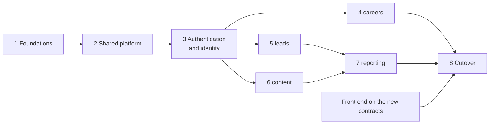

# WM-Admin-Portal-BE Revamp: Implementation Plan

| | |
| --- | --- |
| Target repository | `D:\WM-Admin-Portal-BE` (base package `com.wealthmax`, new empty PostgreSQL database) |
| Legacy repository | `Wealthmax-Admin-Portal-BE` (package `com.wealthmax.adminPortal`), retired at cutover |
| Date | 2026-11-05 |
| Status | **Draft for team review.** Decisions in [section 5](#5-decision-gates) are open unless marked Decided |
| Progress | **Phase 1 is complete** (marked by Sarthak on 2026-11-06). Steps and evidence: `plans/Sarthak-plan/2026-11-05-phase-1-foundations.md` |
| Built from | `docs/revamp-audit-report.md` (findings, target design, ADR register), `docs/admin-portal-module-documentation.md` (what the old application does), and the state of `D:\WM-Admin-Portal-BE` checked on 2026-11-05 |

---

## Table of Contents

1. [What this plan is](#1-what-this-plan-is)
2. [Rules every phase follows](#2-rules-every-phase-follows)
3. [Starting point: the new repository today](#3-starting-point-the-new-repository-today)
4. [Phase map](#4-phase-map)
5. [Decision gates](#5-decision-gates)
6. [Table-to-module ownership map](#6-table-to-module-ownership-map)
7. [Phase 1: Foundations](#phase-1-foundations)
8. [Phase 2: Shared platform](#phase-2-shared-platform)
9. [Phase 3: Authentication and identity](#phase-3-authentication-and-identity)
10. [Phase 4: careers module](#phase-4-careers-module)
11. [Phase 5: leads module](#phase-5-leads-module)
12. [Phase 6: content module](#phase-6-content-module)
13. [Phase 7: reporting module](#phase-7-reporting-module)
14. [Phase 8: Cutover and retirement](#phase-8-cutover-and-retirement)
15. [Findings coverage](#15-findings-coverage)
16. [Work outside this repository](#16-work-outside-this-repository)
17. [Risks](#17-risks)

---

## 1. What this plan is

This is the **master plan** for rebuilding the admin portal back end in `D:\WM-Admin-Portal-BE`.
It says what gets built, in which order, and what each phase must prove before the next starts.
It does not contain code.

The structure follows three decisions already made:

- **New repository, new empty database.** The old project keeps running production until the
  cutover, then it is dumped.
- **Authentication is its own phase** (Phase 3), built after the shared platform and before any
  business module.
- **Then one module per phase:** careers, leads, content, reporting.

**How a phase turns into code.** Each phase below lists *work packages*. When a phase starts, the
developer who owns it writes a detailed plan with the `writing-plans` skill in
`plans/<DevName>-plan/YYYY-MM-DD-<name>.md`. That plan splits each work package into execution
steps of at most 5 files, test first, with exact code. The `executing-plans` skill then runs them
one at a time with a stop for approval after each.

**Patch numbering.** Patch summaries use the phase number plus one letter per execution step.
Phase 3's work packages become `patch-3a-...`, `patch-3b-...` and so on, which keeps the record
in `plans/*/patch-*-summary.md` aligned with this plan.

### What is decided and what is proposed

**Decided by the team** (recorded in the audit report or in earlier sessions):

| Decision | Source |
| --- | --- |
| Rewrite in a new repository with a new, empty database; the old project is dumped after cutover | Team, 2026-11-05 |
| Single tenant, modular monolith | Team, 2026-11-04 |
| Java 21; Spring Boot 3.4 is the floor, not the destination (ADR-008) | Accepted 2026-11-05 |
| Module boundaries enforced by ArchUnit, not Spring Modulith (ADR-005) | Accepted 2026-11-05 |
| Flyway owns the schema (OTH-01) | Team, 2026-11-04 |
| Normalised identities: lowercase email, E.164 phone | Team, 2026-11-04 |
| Rate limiting (Bucket4j) and CAPTCHA deferred, not in this revamp | Team, 2026-11-04 |
| Method security from the first admin route (pulled forward from the old Phase 2) | Team, 2026-11-05 |
| Secret **values** belong to DevOps; all code is this team's | Team, 2026-11-04 |
| Authentication as a separate phase, then module by module | Team, 2026-11-05 (this plan's brief) |

**Everything else is a proposal.** That includes the module list, the roles, the token design, the
URL scheme, the table ownership map and every "recommendation" in this document. Section 5 lists
each open decision and the phase it blocks.

---

## 2. Rules every phase follows

A phase is **done** only when all of these hold. They come from `D:\WM-Admin-Portal-BE\CLAUDE.md`
and the audit report; they are repeated here so each phase can be checked against one list.

1. `mvn compile -q` passes.
2. `mvn test -Dtest=ModuleBoundaryArchitectureTest` passes (no database needed).
3. `mvn test -q` passes. If the database tests could not run, the patch summary says "not run"
   and why. It never says they passed.
4. Every new route has an explicit access level (Public, Authenticated or a named permission),
   and a security-rules test proves both directions: allowed when it should be, 401 or 403 when not.
5. Every admin use case has `@PreAuthorize` on its service method.
6. Every new table has a Flyway migration, and its entity matches it (`ddl-auto: validate` stops
   startup otherwise).
7. Nothing tenant-shaped, and nothing imported from `com.wealthmax.adminPortal`. Behaviour is
   ported, code is not.
8. Request records never carry `id`, roles, status (except a dedicated status-change request),
   audit fields or business numbers.
9. Every list is paged (`PageResponseDto`, size capped at 100, sort fields allow-listed).
10. Every error is a `ProblemDetail` body from the shared advice. No try/catch in controllers.
11. Email and file I/O never run inside a database transaction. Email goes through the outbox.
12. No personal data, OTP codes or tokens in logs.
13. Each **module** phase also ships:
    - its front-end contract in `docs/<module>-api.md` (`api-contract` skill);
    - its data-migration script from the old database (see [Phase 8](#phase-8-cutover-and-retirement));
    - the business rules from its part of the behaviour inventory, written as tests.
14. A patch summary per execution step, with verification results quoted from real runs.
15. `review-branch` over the whole branch before the PR into `Dev`.

---

## 3. Starting point: the new repository today

Checked on 2026-11-05.

| Area | State |
| --- | --- |
| Source control | **Not a git repository.** Nothing is pushed |
| Build | `pom.xml`: Spring Boot **3.5.16**, Java 21, Flyway (`flyway-core` + `flyway-database-postgresql`), MapStruct 1.6.3, springdoc 2.8.17, jjwt 0.12.5, Azure Blob 12.25.0, POI 5.2.3, ArchUnit 1.3.0, Testcontainers, Actuator |
| Code | `WmAdminPortalApplication.java` only. `common/` is empty |
| Schema | `db/migration/` is empty. `ddl-auto: validate`, `baseline-on-migrate: false` |
| Config | `application.yml` (tracked), `application-local.yml` and `application-staging.yml` (gitignored), `application.yml.example`, test `application-test.yml` |
| Tooling | `CLAUDE.md`, `AGENTS.md`, `.claude/` (skills, agents, commands, rules, hooks) rewritten for this single-tenant application |
| Docs | Copies of the audit report, the module documentation and the careers IN contract in `docs/` |

### Conflicts to settle before code is written

These were found while writing this plan. Each one is a gate in section 5.

| # | Conflict | Why it matters | Gate |
| --- | --- | --- | --- |
| 1 | The tracked `application.yml` still has a **literal secret value** in one key, and fallback values on others. The pre-commit hook (rule C1) blocks the commit | The repository cannot get its first commit until DevOps replaces those values with `${VARIABLE}` and no fallback. This team does not edit them | Phase 1a |
| 2 | The pom is on **Boot 3.5.16**. 3.5's open-source support ended 2026-06-30 | Accepted ADR-008 says to set the pom "straight to the newest Spring Boot line still in open-source support" while there is no code. 3.5.16 does not meet that | D-01 |
| 3 | Skills and `CLAUDE.md` route everything under `/api/v1/<resource>` with per-route rules. The audit report (6.2, 6.3) uses two chains: `/api/public/**` and `/api/admin/**` | Every controller and the whole front-end contract depend on this. It cannot change cheaply after Phase 3 | D-03 |
| 4 | Skills name the shared exceptions `ResourceNotFoundException`, `DuplicateResourceException`, `InvalidDataException`, `UnauthorizedException`. The report (6.4) names `NotFoundException`, `ConflictException`, `BusinessRuleException`, `AuthenticationFailedException` | Every service throws these | D-04 |
| 5 | The pom carries Testcontainers. The `integration-testing` skill uses local PostgreSQL with guards and no Docker | Decides how every database test is written, and whether CI can run them | D-02 |
| 6 | `.github/modernize/java-upgrade/` is in the folder. It is a leftover from an upgrade tool and would be committed | Noise in the first commit | Phase 1a |

---

## 4. Phase map

| Phase | Name | Delivers | Depends on | Report 6.5 equivalent |
| --- | --- | --- | --- | --- |
| 1 | Foundations (complete, 2026-11-06) | Git, runtime line, ADR files, `common` kernel, boundary test, test infrastructure, CI, behaviour inventory | Gates D-01 to D-07 | Phase 1 |
| 2 | Shared platform | Security skeleton (deny by default), audit log, notification outbox and templates, file storage | Phase 1; gates D-03, D-09, D-10 | Phase 2 (platform half) |
| 3 | **Authentication and identity** | Users, roles, password + OTP challenge login, access and refresh tokens, logout, password reset, user management, identity data migration | Phase 2; gates D-11 to D-15, D-19 | Phase 2 (identity half) |
| 4 | careers | Jobs, applications, departments, resume upload and download, job expiry | Phase 3; gates D-16, D-17 | Phase 3.1 |
| 5 | leads | Website leads, advisers, referrals, Excel data records | Phase 3 | Phase 3.2 |
| 6 | content | Newsletters, subscribers, replies, authors, team, page headers, home stats, images | Phase 3; gate D-10 | Phase 3.3 |
| 7 | reporting | Dashboards, Excel export | Phases 5 and 6 | Phase 3.4 |
| 8 | Cutover and retirement | Rehearsed data migration, front-end switch, rollback window, old system retired | All of the above, plus the front end | Phase 4 |



**Order versus parallel work.** The default is one module at a time, in the order above. After
Phase 3, careers, leads and content don't depend on each other (provided departments stay in
careers, see section 6). So with three developers they *can* run in parallel, one module each.
Reporting has to wait for leads and content. Phases 1 to 3 should stay sequential: everything after
them builds on their conventions.

---

## 5. Decision gates

Each gate must be decided before the work it blocks starts. The recommendation column is the
AI's suggestion, **not a decision**. Record each decision as an ADR file in
`D:\WM-Admin-Portal-BE\docs\adr\` (template:
`.claude/skills/architecture-designer/references/adr-template.md`).

| Gate | Decision needed | Options | Recommendation (proposal) | Blocks |
| --- | --- | --- | --- | --- |
| D-01 | Runtime line (ADR-008 follow-up) | Stay on Boot 3.5.x; move to the newest supported 4.x line now | Move now, using the `dependency-upgrade` skill. There is no code, so this is the cheapest moment it will ever be. Boot 4 also means springdoc 3.x and Jackson 3 | Phase 1b |
| D-02 | Test infrastructure (ADR-007) | Testcontainers (Docker on every machine); local PostgreSQL with guards (no Docker) | Testcontainers if every developer can run Docker, because only it lets CI run database tests. Otherwise local PostgreSQL, and remove Testcontainers from the pom | Phase 1h |
| D-03 | URL scheme and filter chains (new ADR-010) | `/api/v1/<resource>` with per-route rules (skills today); `/api/public/**` + `/api/admin/**` (report) | Combine them: `/api/v1/public/**` and `/api/v1/admin/**`. It keeps the version prefix the skills use and the two chains the report wants. The admin chain can never be opened by a mistyped rule | Phase 2a |
| D-04 | Error contract and exception names (new ADR-011) | Skill names; report names | `ProblemDetail` (RFC 9457) everywhere, as both sources agree. Keep the skills' four names, since the skills already teach them, and add `BusinessRuleException` (422) only if a module needs it | Phase 1e |
| D-05 | Mapping style | MapStruct everywhere; per-module choice (skills allow both) | MapStruct with `unmappedTargetPolicy = ERROR` for every new module (DTO-11) | Phase 1e |
| D-06 | ADR-001, ADR-002 and ADR-009 acceptance | Accept, change or reject | Accept. ADR-009's core (new repository, new database) is already the team's decision. What is left to accept is the single rehearsed cutover | Phase 1c |
| D-07 | CI pipeline | Azure Pipelines now; later | Now: `mvn verify` on every PR into `Dev`, so the boundary test and unit tests guard every merge from the first module | Phase 1i |
| D-08 | Table-to-module ownership | Section 6 of this plan | Accept section 6, including departments in careers | Phase 3 |
| D-09 | Outbox mechanism (ADR-006) | Hand-rolled outbox table; Spring Modulith event registry | Hand-rolled. ADR-005 already rejected Modulith, so adding it for the outbox alone is a dependency for one feature | Phase 2c |
| D-10 | Storage containers | One private container for everything; private container for personal files plus a public-read container for website media | Two containers. CVs must be private (SEC-08), but team photos, author pictures and page-header images are shown on the public website. Serving those through short-lived SAS links would break caching | Phase 2f |
| D-11 | Roles and permissions model | Report's roles (`SUPER_ADMIN`, `ADMIN`, `HR`, `CONTENT_EDITOR`, `VIEWER`) with permissions mapped in code; fewer roles; permissions in tables | Role stored on the user as a string enum, permissions mapped in code (`Role` to `Set<Permission>`). Tables for roles and permissions only if roles must change without a release | Phase 3a |
| D-12 | Token signing and refresh delivery | HS256 with the key from `jwt.secret` (jjwt, already in the pom); RS256 with Spring's resource server. Refresh token in an HttpOnly cookie or in the response body | HS256 from configuration with a `kid`, now; asymmetric keys later as their own ADR. Cookie delivery needs the front end and API on the same site: confirm the front-end hosting first | Phase 3c |
| D-13 | First admin account | Startup runner that creates one `SUPER_ADMIN` from environment variables when the users table is empty (local and staging only); a manual SQL insert by DevOps; wait for the user data migration | The guarded startup runner for local and staging. Production gets its admins from the identity data migration | Phase 3g |
| D-14 | Old `roles_and_access` rows and self-registered `USER` accounts | Port `roles_and_access` as its own table; fold it into the user's role; drop it. Keep, disable or drop old `USER` accounts | Fold into the user's role (OTH-17: today it does not even control login). Disable old self-registered `USER` accounts and list them for review | Phase 3h |
| D-15 | Password policy and lockout | Length only; length + breached-password check. Lockout after N failures, or none | Minimum 12 characters, maximum 128, no composition rules; temporary lockout after 10 failed password attempts. SEC-13's lockout part was **not** deferred, only rate limiting and CAPTCHA were | Phase 3d |
| D-16 | careers UK/IN merge (ADR-003) and cooldown | Merge into one careers module with `region` as an attribute; keep UK and IN separate | Merge. The tables are new anyway, so the merge is a mapping in the careers data-migration script. Needs a cooldown rule per region (IN has 6 months today; UK has none). **Decided 2026-11-06 (Sarthak):** the cooldown compares calendar dates, not exact times. The time zone that defines the date is still to be chosen | Phase 4 |
| D-17 | Deletion and retention of personal data | Hard delete; soft delete; anonymise after N months | One policy for every personal-data table (applicants, leads, referrals, subscribers), agreed with whoever owns UK GDPR compliance. Admin deletes are audited in every option | Phase 4 |
| D-18 | Number of production instances | One; several | If more than one, add ShedLock for scheduled jobs. The outbox dispatcher uses `SKIP LOCKED` and is safe either way | Phase 2e |
| D-19 | Data-migration tooling | Restore the old tables into a `legacy_import` schema in the new database, then transform with SQL; `postgres_fdw` between the two databases; a Java batch job | `legacy_import` schema plus plain SQL scripts, one per module, kept in `data-migration/` (outside the Flyway path). Easy to rehearse, no extra infrastructure, and the schema is dropped after cutover | Phase 3h |

---

## 6. Table-to-module ownership map

**Proposed** (gate D-08). The audit report says ADR-002 can't be written without this map. Rules:
one table has one owning module; no foreign key or JPA relationship crosses modules; another
module's data is referred to by id.

| Old table | New module | New table (proposed) | Notes |
| --- | --- | --- | --- |
| `users` | identity | `users` | Email lowercased with a `CHECK (email = lower(email))` and unique index. Role as a string. Adds `status` and `token_version` |
| `otp` | identity | `otp_challenge` | Redesigned: hashed code, attempts, expiry, used flag, bound to one user. Old rows are not migrated |
| (none) | identity | `refresh_token`, `password_reset_token` | New. Stored hashed |
| `roles_and_access` | identity | (none, per D-14) | Folded into `users.role` |
| `careers` + `careers_in` | careers | `job` | `region` (UK, IN). Job number from a sequence per region. Status not null |
| `careers_in_skill_options` | careers | `job_skill` | |
| `applicant` + `applicant_in` | careers | `application` | `job_id` is a real foreign key (same module). Normalised email and phone for the cooldown |
| `applicant_in_industry_experience`, `applicant_in_skills` | careers | `application_industry`, `application_skill` | |
| `departments` | careers | `department` | **Moved from content to careers.** It only serves job postings, and keeping it in careers avoids a careers-to-content dependency |
| `appointed_representative` | leads | `lead` | `category` as an enum. `form_data` kept as `jsonb` |
| `advisers` | leads | `adviser` | `contact_number` becomes text in E.164 (OTH-20) |
| `referrals` + `referral_services` | leads | `referral`, `referral_service` | |
| `excel_data` | leads | `excel_data` | A record of an uploaded file. The file is in storage |
| `newsletters` | content | `newsletter` | Foreign key to `author` is fine: same module |
| `newslettersreply` | content | `newsletter_reply` | Real foreign key with an explicit `ON DELETE` rule (OTH-21) |
| `news_letter_subscribers` | content | `subscriber` | Unique on lowercased email. Unsubscribe token (OTH-28) |
| `authors` | content | `author` | Image columns hold storage keys |
| `team_members` | content | `team_member` | |
| `page_headers` | content | `page_header` | |
| `home_page_count_entity` | content | `home_stats` | Exactly one row, enforced by the schema |
| `images` | content | `image` | Metadata only. Bytes move to storage (OTH-27) |
| (none) | common | `audit_log` | Append-only |
| (none) | notification | `outbox_message` | |
| Sequence `careers_in_job_number_seq` | careers | `job_number_seq_in` (and `_uk` if D-16 keeps a UK series) | Restarted after the data migration at the highest migrated number plus one |

reporting owns no tables. It reads through the leads and content service interfaces.

---

## Phase 1: Foundations

**Goal.** A repository under source control, on the agreed runtime, with the shared kernel, the
boundary test, the test infrastructure and CI in place. Nothing visible to users.

**Status.** Complete, marked by Sarthak on 2026-11-06. The step-by-step record and the evidence are
in `plans/Sarthak-plan/2026-11-05-phase-1-foundations.md` and the patch summaries in that folder.

**Entry gates.** D-01, D-02, D-04, D-05, D-06, D-07. Conflict 1 in section 3 (DevOps).

| WP | Work package | Contents |
| --- | --- | --- |
| 1a | Source control | DevOps replaces the literal secret values in `application.yml` (conflict 1). Remove or ignore `.github/modernize/`. `git init`, first commit, create the Azure DevOps repository, push, create `Dev` and `Staging`, install the pre-commit hook. Record the remote URL in `CLAUDE.md`. Point `CLAUDE.md` "Current Phase" at this plan |
| 1b | Runtime line | Apply D-01 to the pom with the `dependency-upgrade` skill. Bump springdoc, MapStruct and ArchUnit to versions that support the line. `mvn compile` and an empty context-load test pass |
| 1c | ADR files | Create `docs/adr/`. Write ADR-001 to ADR-009 with their real status, and new ADRs for every gate decided so far (D-03 URL scheme, D-04 error contract, and so on) |
| 1d | Kernel: persistence and config | `BaseEntity` (id, `createdAt`, `updatedAt` as `Instant`), `AuditableEntity` (`createdBy`, `updatedBy`), JPA auditing with an `AuditorAware` that returns empty until Phase 3 and a timestamp provider that reads the `Clock` as it is (not cut to microseconds: the cooldown compares dates only, D-16), a `Clock` bean (UTC), typed `@ConfigurationProperties` records for `app.*` and `jwt.*` |
| 1e | Kernel: errors and paging | The shared exceptions (D-04), one `@RestControllerAdvice` extending `ResponseEntityExceptionHandler` that returns `ProblemDetail` with `code`, `traceId` and field `errors`; framework errors keep their own status (404, 405, 413, 415); 4xx logged at WARN without a stack, 5xx at ERROR with one; unique violations detected by SQLState `23505` and constraint name. `PageResponseDto<T>` and a pageable guard (size at most 100, sort allow-list) |
| 1f | Kernel: logging | `TraceIdFilter` ordered **before** the security chain, so rejected requests are logged too (SEC-29, B14). `traceId` in MDC and in every error body. JSON logs to stdout for staging and production (OTH-23). A rule and a test that request logging never prints bodies or query strings |
| 1g | Boundary test | One generic `ModuleBoundaryArchitectureTest`: no module reaches another module's `entity`, `repository`, `mapper` or `service.impl`; `common` imports no module; no cycles between modules; no `com.wealthmax.adminPortal` import. Written before the first module, so every new module is covered on day one |
| 1h | Test infrastructure | Apply D-02. Port the guards (`LocalDatabaseOnlyInitializer`, the empty-tables extension) or set up the Testcontainers base class. First database test: Flyway migrates an empty database and `validate` passes |
| 1i | CI | Azure Pipelines: `mvn verify` on every PR into `Dev`. Database tests run in CI only if D-02 chose Testcontainers |
| 1j | Behaviour inventory | `docs/behaviour-inventory.md`: for every flow being kept, the business rules it must preserve, taken from the module documentation. Examples: the IN cooldown, the `WFA-IN-0001` job number series, the lead email routing by category, referral numbers, slug rules. Each rule is tagged with the phase that turns it into a test |

**Exit criteria.**

- [x] The repository is on Azure DevOps with `Dev` and `Staging`, and CI is green on `Dev`. Ticked
  on Sarthak's word. Not confirmed: the `origin` remote is a GitHub URL (open item 5 in the Phase 1
  plan).
- [x] `mvn verify` passes, including `ModuleBoundaryArchitectureTest` and the first database test.
  Run on 2026-11-06: `mvn -B clean verify`, 103 tests, 0 failures, BUILD SUCCESS.
- [x] A request to an unknown path returns a `ProblemDetail` 404 with a `traceId`, not a 500.
  Proven in patch 1h4.
- [x] ADR files exist for every decision made so far. ADR-010 is reserved for gate D-03, which is
  still undecided.

**Findings closed or guarded.** SEC-29 (trace and logging rules), SEC-30, SEC-33, DTO-05, DTO-07
(status conventions), DTO-08 (paging type), DTO-11, SOL-04, SOL-06 (`Clock`), SOL-08, SOL-09
(OSIV already off; transaction rules), OTH-01, OTH-03, OTH-06 (the context-load test catches
wiring bugs), OTH-11 (UTC everywhere), OTH-13 (entity conventions), OTH-16, OTH-22, OTH-23, OTH-24.

---

## Phase 2: Shared platform

**Goal.** Everything the modules share at runtime: the security skeleton, the audit log, email,
and file storage. After this phase every route is denied unless a later phase opens it.

**Entry gates.** D-03, D-09, D-10, D-18.

| WP | Work package | Contents |
| --- | --- | --- |
| 2a | Security skeleton (`common.security`) | Two filter chains per D-03. Public chain: an explicit allow-list, empty for now apart from health. Admin chain: `authenticated()`. Fallback: `denyAll()`. `@EnableMethodSecurity`. JSON 401 entry point and JSON 403 handler that return `ProblemDetail` (SEC-23). Stateless sessions, CSRF off (bearer only). CORS from properties per profile, no `@CrossOrigin` anywhere (SEC-31). Swagger on in `local` only, or admin-only elsewhere (SEC-28). Actuator: `health` public, nothing else. Security headers (`nosniff`, frame deny). A reusable `SecurityRulesTestSupport` for the per-module rule tests. **No token handling yet:** that is Phase 3 |
| 2b | Audit log (`common.audit`) | Migration `V1__common_audit_log.sql`. `AuditService.record(actor, action, entityType, entityId)`, append-only, written in the caller's transaction. Never stores personal data values, only ids. Used from Phase 3 on for role changes, PII reads, deletes and exports |
| 2c | Outbox (`notification`) | Migration for `outbox_message` (id, type, recipient, subject, template id, model as `jsonb`, status, attempts, next attempt time, last error). `NotificationService.enqueue(EmailRequest)` writes a row in the **caller's** transaction, so an email exists only if the data was committed (OTH-04). `EmailRequest` validates one address and rejects `,` `;` CR and LF (SEC-18) |
| 2d | Templates (`notification`) | Thymeleaf renderer that escapes every value by default (SEC-17). Missing variables fail loudly; templates are loaded and checked at startup (OTH-18). Port the live templates only (not `CallBack`, `CallBackLead`). Logo and links from configuration, no third-party template site (OTH-28) |
| 2e | Sender (`notification`) | Scheduled dispatcher: picks due rows with `FOR UPDATE SKIP LOCKED`, sends **outside** any transaction, retries with backoff, marks failed after N attempts. Mailgun adapter on `RestClient` with connect and read timeouts (OTH-05). Logs message id and status, never the body or address. Metrics for outbox lag and failures |
| 2f | Storage (`common.storage`) | `FileStorage` interface; Azure adapter with one `BlobContainerClient` bean per container (D-10); server-generated keys (UUID plus allow-listed extension); type check by magic bytes, not the client's content type; size cap; read SAS under one hour for private files (SEC-08); storage errors mapped by status, cause logged (OTH-19); upload collisions throw (SEC-35). An in-memory fake for tests. No listing endpoint, ever |

**Exit criteria.**

- Every path in the application returns 401 or 403 (or 404 for unknown paths) apart from health.
- A test enqueues an email inside a transaction that rolls back, and proves no email is sent.
- A test proves a Mailgun failure leaves the outbox row retrying and never fails the caller.
- A test proves an HTML file renamed to `.pdf` is rejected by storage.

**Findings closed or guarded.** SEC-01 (deny by default), SEC-17, SEC-18, SEC-20 (size caps),
SEC-23 (handlers), SEC-28, SEC-29 (audit trail), SEC-31, SEC-35, SOL-06 (ports for email and
storage), SOL-07, OTH-04, OTH-05, OTH-18, OTH-19, OTH-28 (template part).

---

## Phase 3: Authentication and identity

**Goal.** A person can be provisioned by an admin, sign in with password plus OTP, stay signed in
with rotating refresh tokens, sign out, reset a forgotten password and be managed by an admin.
Every later module relies on this phase for its `@PreAuthorize` checks.

This phase is kept separate, as agreed, because the audit's worst findings are all here: OTP not
bound to the user (SEC-04), master OTP (SEC-05), hard-coded key (SEC-06), public admin creation
(SEC-02, SEC-03) and non-revocable tokens (SEC-11).

**Entry gates.** D-08, D-11, D-12, D-13, D-14, D-15, D-19.

### Login design (from audit report 6.2, adjusted to the decisions so far)

```
Step 1  POST login {email, password}
        - email normalised (trim, lowercase)
        - password checked; failure counter per user (D-15)
        - on success: otp_challenge row {user, purpose LOGIN, hash(6-digit SecureRandom code),
          expires in 5 min, attempts 0, used false}; OTP email enqueued in the same transaction
        - the response is the same shape whether or not the email exists or the password matched
          -> 200 {challengeId}

Step 2  POST login/verify {challengeId, code}
        - checked against that challenge only; attempts at most 5; expired or used -> fail
        - on success: challenge marked used, access token issued, refresh token family started
          -> 200 {accessToken, expiresIn} + refresh token (cookie or body, D-12)

Refresh  rotate on every use; a reused old token revokes the whole family
Logout   revokes the family -> 204
```

No master code. No public "validate OTP" endpoint. No code in any log line.

### Work packages

| WP | Work package | Contents |
| --- | --- | --- |
| 3a | Schema | Migrations for `users` (normalised unique email, `password_hash`, names, country, `role` string not null, `status`, `token_version`, failed-login counter, lock-until, audit columns), `otp_challenge`, `refresh_token` (family id, hash, expiry, revoked, replaced-by), `password_reset_token` (hash, expiry, used). Indexes on the lookup keys |
| 3b | User model | `User` entity (not a `UserDetails`), `Role` and `Permission` enums per D-11, `UserRepository`, a separate `SecurityUserDetailsService` adapter, one `PasswordEncoder` bean (`DelegatingPasswordEncoder`, BCrypt cost 12). Migrated cost-8 and cost-10 hashes still verify and are upgraded on the next login (SEC-27). `EmailNormalizer` in `common.util` |
| 3c | Tokens (`common.security`) | Access token per D-12: 10 to 15 minutes, claims `sub` (user id), `roles`, `ver` (token version), `jti`, `typ=access`, header `kid`. The key comes from configuration (SEC-06); DevOps supplies the value. The filter rejects anything not `typ=access` and catches `JwtException` so a bad token on a public route is treated as anonymous (SEC-23). `UserPrincipal` carries id and authorities. The token version is checked against the user, so a role or password change ends every old token |
| 3d | Login | Step 1 and step 2 above. Login success and failure written to the audit log (no codes, no passwords). Lockout per D-15. Uniform responses on public flows (SEC-25) |
| 3e | Refresh and logout | Opaque 256-bit refresh token, stored as a hash with the pepper from `app.security.token-pepper`, rotated on every use, reuse detection revokes the family, logout revokes the family (SEC-11). A scheduled purge of expired challenges and tokens (OTH-07) |
| 3f | Password reset and change | Forgot: always 202, the same response for unknown emails; a single-use hashed token valid for about 30 minutes, sent as a link to `app.frontend.base-url` + `reset-password-path` through the outbox. Reset: sets the password, bumps `token_version`, revokes every refresh family. A password is never emailed (SEC-10). Change own password: old password required, policy from D-15, same revocation (SEC-26) |
| 3g | User management | Admin endpoints for users, each with `@PreAuthorize`. Create (admin-provisioned, no public signup: SEC-14). Update names and country only, never role or email (SEC-03). A separate role-change endpoint for `SUPER_ADMIN` only, audited, bumps `token_version` (SEC-02). Activate and deactivate instead of delete. `/me` read and update for the signed-in user. First admin per D-13 |
| 3h | Identity data migration | `data-migration/01_identity.sql` (D-19): copy users with lowercased emails; report case-variant duplicates **before** the copy, since they block login today (SEC-24); map ordinal roles (0 = USER, 1 = ADMIN) to the new roles; apply D-14 to `roles_and_access` and self-registered accounts; copy password hashes as they are. OTP rows are not copied. Rehearse on a copy of production on staging and compare row counts |
| 3i | Contract and proof | `docs/identity-api.md` for the front end. A security-rules test for every identity route. An end-to-end test: admin creates a user, the user signs in with password plus OTP (email captured from the outbox), refreshes, signs out, and the old refresh token is refused |

### Old endpoints to new endpoints

Paths are shown relative to `/api/v1` with the chain split recommended in D-03.

| Old (v1) | New | Access |
| --- | --- | --- |
| `POST /auth/signup` | **Removed** (SEC-14) | |
| `POST /otp/sendOtp` | `POST /public/auth/login` (step 1) | Public |
| `POST /auth/signin` | `POST /public/auth/login/verify` (step 2) | Public |
| `POST /otp/validateOtp` | **Removed** (SEC-12) | |
| `POST /auth/refresh-token` | `POST /public/auth/refresh` | Public, needs a refresh token |
| `POST /auth/signout` | `POST /public/auth/logout` | Public, needs a refresh token |
| `PUT /user/forgetpassword/{EmailId}` | `POST /public/auth/password/forgot` and `POST /public/auth/password/reset` | Public |
| `PUT /user/update/password/{userid}` | `PUT /admin/me/password` | Authenticated |
| `GET /user/{userid}` | `GET /admin/me`, and `GET /admin/users/{id}` | Authenticated; `user:manage` |
| `PUT /user/update/{id}` | `PATCH /admin/me`, and `PATCH /admin/users/{id}` (no role, no email) | Authenticated; `user:manage` |
| `GET /admin` | `GET /admin/users` (paged) | `user:manage` |
| `POST /admin` | `POST /admin/users` (201) | `user:manage` |
| (new) | `PUT /admin/users/{id}/role` (204, audited) | `SUPER_ADMIN` |
| (new) | `PUT /admin/users/{id}/status` (204) | `user:manage` |
| `/roles-access/*` (4 endpoints) | Per D-14. Recommended: removed, replaced by the role endpoint | |

**Exit criteria.**

- The front end can sign in against the new back end on staging.
- Every SEC-02 to SEC-06, SEC-10 to SEC-12 scenario from the audit report is a test that now fails
  the way it should: for example, an OTP issued to user A cannot sign in user B.
- The identity data-migration script has been run against a copy of production with matching
  counts, and a migrated admin has signed in.

**Findings closed or guarded.** SEC-02, SEC-03, SEC-04, SEC-05, SEC-06, SEC-10, SEC-11, SEC-12,
SEC-13 (per-challenge cap and lockout only; rate limiting stays deferred), SEC-14, SEC-23, SEC-24,
SEC-25, SEC-26, SEC-27, SEC-34, OTH-07, OTH-17 (roles part), SOL-11.

---

## Phase 4: careers module

**Goal.** Jobs and job applications for both regions, with resumes kept private.

**Entry gates.** D-16 (merge and cooldown), D-17 (retention). D-08 must have kept departments in
careers.

**Reference.** `docs/careers-applicant-in-api.md` is the contract and the business rules of the
existing IN module, the best-built part of the old code. Port its rules, not its classes.

| WP | Work package | Contents |
| --- | --- | --- |
| 4a | Schema | Migrations for `department`, `job`, `job_skill`, `application` and its collection tables, the job-number sequence(s). Indexes for the real filters: job status and region, application job id, the cooldown key (normalised email, normalised phone, cooldown end) (OTH-09). Explicit column lengths or `TEXT` (OTH-26). `@Version` columns on mutable tables (OTH-14) |
| 4b | Departments | Admin CRUD, public list. Jobs refer to a department by id |
| 4c | Jobs | Admin create, update (`PATCH`, partial), status change (204), delete per D-17. Status defaults to `ACTIVE` and is never null (DTO-13). Job number from the database sequence, not updatable (OTH-08). Lists sorted by id or creation time, not by the text job number (OTH-25). Public read model: `ACTIVE` only, without `note` or internal fields (SEC-21, DTO-10) |
| 4d | Resume upload | The public form first uploads the resume (and cover letter) through a public endpoint that checks type, size and magic bytes and returns an **upload reference**. The application submit must present a reference issued for it. A free-text file name is never accepted (SEC-22) |
| 4e | Applications | Public submit: the job must exist and be `ACTIVE`; its title is copied on the server, not taken from the client (DTO-13); email and phone normalised (E.164) before the cooldown check (SEC-19), which compares dates only (D-16); size caps on every text and list field; the two emails enqueued through the outbox (OTH-04). Admin: paged **summary** list and a separate **detail** read (DTO-10); resume download through a short-lived SAS link (SEC-08); delete per D-17, audited (SEC-15); PII reads audited |
| 4f | Job expiry | One daily bulk `UPDATE job SET status = 'INACTIVE' WHERE status = 'ACTIVE' AND apply_by < :today` with an explicit business time zone, for both regions (OTH-02, OTH-11). ShedLock if D-18 says several instances |
| 4g | Data migration and contract | `data-migration/02_careers.sql`: `careers` (UK) and `careers_in` (IN) into `job` with a region; `applicant` and `applicant_in` into `application`, with job ids resolved to the new job rows; departments; blob names copied as storage keys; sequences restarted after the highest migrated number. `docs/careers-api.md` |

### Old endpoints to new endpoints

| Old | New | Access |
| --- | --- | --- |
| `GET/POST/DELETE /departments` | `GET /public/departments`; `POST`, `PATCH`, `DELETE /admin/departments[/{id}]` | Public; `job:write` |
| `POST /careers/createJob`, `POST /careers/IN/createJob` | `POST /admin/jobs` (201 + `Location`) | `job:write` |
| `GET /careers/getAll`, `GET /careers/IN/getAll`, `GET .../get/status/{status}` | `GET /public/jobs?region=&department=&q=` (paged, `ACTIVE` only); `GET /admin/jobs?status=&region=` (paged) | Public; `job:read` |
| `GET /careers/get/{id}`, `GET /careers/IN/get/{id}` | `GET /public/jobs/{id}` (`ACTIVE` only); `GET /admin/jobs/{id}` | Public; `job:read` |
| `PUT /careers/update/{id}`, `PUT /careers/IN/update/{id}` | `PATCH /admin/jobs/{id}` | `job:write` |
| `PUT /careers/update/{id}/{status}`, `PUT /careers/IN/update/{id}/{status}` | `PUT /admin/jobs/{id}/status` (204) | `job:write` |
| `DELETE /careers/delete/{id}`, `DELETE /careers/IN/delete/{id}` | `DELETE /admin/jobs/{id}` (204) | `job:write` |
| `POST /blob/upload` (used by the apply form) | `POST /public/applications/uploads` (returns an upload reference) | Public |
| `POST /applicant/addApplicant`, `POST /applicant/IN/addApplicant` | `POST /public/applications` (201, minimal body, no PII echoed) | Public |
| `GET /applicant/getAllApplicant`, `GET /applicant/IN/getAllApplicant` | `GET /admin/applications` (paged summary) | `applicant:read` |
| `GET /applicant/getApplicant/{id}`, `GET /applicant/IN/getApplicant/{id}` | `GET /admin/applications/{id}` (detail) | `applicant:read` |
| `GET /blob/download/{filename}`, `POST /blob/download/bulk` | `GET /admin/applications/{id}/resume` (short-lived link). Bulk download only if the admin portal really uses it, then streamed and capped (SEC-20) | `applicant:read` |
| `DELETE /applicant/delete/{id}`, `DELETE /applicant/IN/delete/{id}` | `DELETE /admin/applications/{id}` (204, audited) | `applicant:delete` |
| `GET /blob/`, `DELETE /blob/blob/{blobName}` | **Removed** (SEC-08) | |

**Exit criteria.** Rule 2 checklist; the cooldown, job-number and email rules from the behaviour
inventory pass as tests; the careers migration script has run against a production copy with
matching counts per region.

**Findings closed or guarded.** SEC-08, SEC-09 (applicant part), SEC-15, SEC-19 (normalisation and
size caps; CAPTCHA and rate limiting deferred), SEC-20, SEC-21 (jobs), SEC-22, DTO-01, DTO-02,
DTO-03, DTO-04, DTO-06, DTO-09, DTO-10, DTO-13, DTO-14, OTH-02, OTH-08, OTH-09, OTH-10, OTH-14,
OTH-21 (job foreign key), OTH-25, OTH-26.

---

## Phase 5: leads module

**Goal.** Website enquiry forms, advisers, referrals and Excel data records, with every personal
data read behind a permission.

**Entry gates.** Phase 3 done. D-17 applies to leads and referrals.

| WP | Work package | Contents |
| --- | --- | --- |
| 5a | Schema | Migrations for `lead`, `adviser`, `referral`, `referral_service`, `excel_data`, with indexes on category and creation time, and on adviser email |
| 5b | Leads | Public submit with `@Valid` and `@Email` (one address only). A `LeadCategory` enum that carries its submitter template, staff template and subject, replacing the if/else chains (SOL-03). Unknown categories rejected with 400, not silently saved. The `{{networkInterested}}` gap fixed in the template (OTH-18, B6). Staff lead address from configuration (OTH-22). Admin: paged list with category and date filters (`LocalDate`, not strings), detail, update (every field the form has, not 4 of 15: OTH-14), delete per D-17, audited. **No `deleteAll`** (SEC-09) |
| 5c | Advisers | Admin CRUD. Contact number as E.164 text (OTH-20). Search by email through a request parameter or body, never a path segment (DTO-09). The `counts` endpoint moves to reporting |
| 5d | Referrals | Public submit. `ReferralNumberGenerator` bean (no static utility). Search with JPA Specifications instead of in-memory filtering. Referral email to the referred person goes through the escaping renderer and the outbox (SEC-17). Admin: paged list and search, by id, by number, delete |
| 5e | Excel data | Admin create (with the file uploaded through storage, not the removed blob API), paged list |
| 5f | Data migration and contract | `data-migration/03_leads.sql`: `appointed_representative` into `lead` (categories mapped; rows with unknown categories listed for review), advisers (phone numbers converted; any that can't be converted listed), referrals, Excel data. `docs/leads-api.md` |

### Old endpoints to new endpoints

| Old | New | Access |
| --- | --- | --- |
| `POST /AppointedRepresentative/addAppointedRepresentative` | `POST /public/leads` (201) | Public |
| `GET /AppointedRepresentative/getAllAppointedRepresentatives[/{category}]` | `GET /admin/leads?category=&from=&to=` (paged) | `lead:read` |
| `PUT /AppointedRepresentative/update/{id}` | `PATCH /admin/leads/{id}` | `lead:write` |
| `DELETE /AppointedRepresentative/delete/{id}` | `DELETE /admin/leads/{id}` (204, audited) | `lead:delete` |
| `DELETE /AppointedRepresentative/deleteAll` | **Removed** (SEC-09) | |
| `GET /AppointedRepresentative/dashboard/...` (3 endpoints) | Moved to reporting (Phase 7) | |
| `POST /adviser/create`, `PUT /adviser/update/{id}`, `DELETE /adviser/delete/{id}` | `POST`, `PATCH`, `DELETE /admin/advisers[/{id}]` | `lead:write` |
| `GET /adviser/getAll`, `GET /adviser/getByCategory/{category}`, `GET /adviser/search/{email}` | `GET /admin/advisers?category=&email=` (paged) | `lead:read` |
| `GET /adviser/counts` | Moved to reporting (Phase 7) | |
| `POST /referral/submit` | `POST /public/referrals` (201) | Public |
| `GET /referral/getAll`, `/get/{id}`, `/number/{referralNumber}` | `GET /admin/referrals?q=&from=&to=` (paged), `GET /admin/referrals/{id}`, `GET /admin/referrals/by-number/{number}` | `lead:read` |
| `DELETE /referral/delete/{id}` | `DELETE /admin/referrals/{id}` (204, audited) | `lead:delete` |
| `POST /ExcelData/add`, `GET /ExcelData/getAll` | `POST /admin/excel-data`, `GET /admin/excel-data` (paged) | `lead:write`; `lead:read` |

**Exit criteria.** Rule 2 checklist; one test per lead category proves the right two emails are
enqueued; the leads migration has run against a production copy with matching counts.

**Findings closed or guarded.** SEC-09 (leads), SEC-18, SOL-01, SOL-02, SOL-03, SOL-05, OTH-15,
OTH-20, plus the module-wide DTO and query findings listed for Phase 4.

---

## Phase 6: content module

**Goal.** Everything the public website reads (newsletters, authors, team, page headers, home
stats, images) and the admin screens that manage it. Drafts are never public.

**Entry gates.** Phase 3 done. D-10 (public media container).

| WP | Work package | Contents |
| --- | --- | --- |
| 6a | Schema | Migrations for `author`, `newsletter`, `newsletter_reply`, `subscriber`, `team_member`, `page_header`, `home_stats` (one row, enforced), `image`. Unique slugs. Indexes on newsletter status, category, author and creation time |
| 6b | Authors | Admin CRUD with pictures uploaded through storage (media container), slug generated by one `SlugGenerator` shared within the module. Public profile by slug |
| 6c | Newsletters | Admin CRUD and status change (`DRAFT`, `PUBLISHED`, ...). Public reads (list by category, by slug) return `PUBLISHED` only (SEC-21, B11). Reply counts by query, not by loading rows (OTH-10). Public category counts as one `GROUP BY` |
| 6d | Subscribers and replies | Public subscribe (normalised email, unique), welcome email through the outbox, **unsubscribe link and endpoint** (OTH-28). Public reply submit. Admin: paged subscribers, replies per newsletter, reply delete |
| 6e | Team, page headers, home stats | Admin CRUD with full updates, nothing skipped (OTH-14). Public reads. Home stats as a single-row resource (`GET` and `PUT`) |
| 6f | Images | Upload through storage only; no disk, no `@Lob` (OTH-27, SEC-16). Type from magic bytes, `nosniff`, served from the media container. Admin delete |
| 6g | Data migration and contract | `data-migration/04_content.sql`, in order: authors, newsletters (slugs computed here, replacing the old startup backfill: OTH-12), replies (orphans listed and dropped), subscribers (deduplicated by lowercased email), team, page headers, home stats, image metadata. Image bytes copied out of the old `@Lob` column into storage by a one-off step in the rehearsal runbook. `docs/content-api.md` |

### Old endpoints to new endpoints

| Old | New | Access |
| --- | --- | --- |
| `POST /newsletters/save`, `PUT /newsletters/update/{id}`, `DELETE /newsletters/delete` | `POST /admin/newsletters`, `PATCH /admin/newsletters/{id}`, `DELETE /admin/newsletters/{id}` | `newsletter:write` |
| `PATCH /newsletters/{id}/status` | `PUT /admin/newsletters/{id}/status` (204) | `newsletter:publish` |
| `GET /newsletters/findAll`, `/find/{id}`, `/find/category/{category}`, `/filter/{startDate}/{lastDate}` | `GET /public/newsletters?category=` (published, paged); `GET /admin/newsletters?status=&from=&to=` (paged); `GET /admin/newsletters/{id}` | Public; `newsletter:write` |
| `GET /newsletters/slug/{slug}` | `GET /public/newsletters/{slug}` (published only) | Public |
| `GET /newsletters/category/count` | `GET /public/newsletters/category-counts` | Public |
| `POST /newsletters/add/subscribers` | `POST /public/subscribers` (201) and `POST /public/subscribers/unsubscribe` (token) | Public |
| `GET /newsletters/subscribers` | `GET /admin/subscribers` (paged) | `newsletter:read` |
| `POST /newsletters/save/reply` | `POST /public/newsletters/{id}/replies` | Public |
| `GET /newsletters/getall/reply/{id}`, `GET /newsletters/{id}/reply-count`, `DELETE /newsletters/delete/reply/{id}` | `GET /admin/newsletters/{id}/replies` (paged, count included), `DELETE /admin/replies/{id}` | `newsletter:write` |
| `POST /author/create`, `PUT /author/{authorId}`, `DELETE /author/delete/{id}`, `GET /author/getAll` | `POST`, `PATCH`, `DELETE`, `GET /admin/authors[/{id}]` | `content:write` |
| `GET /author/{slug}` | `GET /public/authors/{slug}` | Public |
| `/team-members/*` (5 endpoints) | `GET /public/team-members`; `POST`, `PATCH`, `DELETE`, `GET /admin/team-members[/{id}]` | Public; `content:write` |
| `/page-header/*` (5 endpoints) | `GET /public/page-headers`; `POST`, `PATCH`, `DELETE`, `GET /admin/page-headers[/{id}]` | Public; `content:write` |
| `/homepagecount/*` (3 endpoints) | `GET /public/home-stats`; `PUT /admin/home-stats` | Public; `content:write` |
| `/image/*` (3 endpoints) | `POST /admin/images` (201), `DELETE /admin/images/{id}`; images served from the media container URL | `content:write` |

**Exit criteria.** Rule 2 checklist; a test proves a draft newsletter is unreachable by id, slug
and category; the content migration (including image bytes) has run against a production copy.

**Findings closed or guarded.** SEC-16, SEC-21 (newsletters), OTH-12, OTH-21 (replies), OTH-27,
OTH-28, plus the module-wide DTO and query findings listed for Phase 4.

---

## Phase 7: reporting module

**Goal.** Admin dashboards and the leads Excel export. Read-only. No tables of its own.

**Entry gates.** Phases 5 and 6 done. leads and content expose the query methods reporting needs
on their **service interfaces** (counts by category and period, a streamed export page). Reporting
never touches their repositories.

| WP | Work package | Contents |
| --- | --- | --- |
| 7a | Dashboards | Lead counts by category over a period, adviser counts by period. Period is an enum (`TODAY`, `THIS_MONTH`, `THIS_YEAR`, `CUSTOM` with `from` and `to`), calculated in the business time zone from midnight (OTH-11, OTH-15, SOL-03). One `GROUP BY` per chart, not one query per category (OTH-10) |
| 7b | Excel export | Leads by category as `.xlsx`. Apache POI only in this module. Streamed, not built in memory. `Content-Disposition` built with `ContentDisposition` (SEC-32). Category validated as an enum. Every export written to the audit log (it is a bulk PII read) |
| 7c | Contract | `docs/reporting-api.md` |

| Old | New | Access |
| --- | --- | --- |
| `GET /AppointedRepresentative/dashboard/getCount[/filter]`, `.../filter/{category}/{startDate}/{lastDate}` | `GET /admin/reports/leads/summary?period=&from=&to=`; the row list becomes the leads list filter in Phase 5 | `report:read` |
| `GET /adviser/counts` | `GET /admin/reports/advisers/summary?period=&from=&to=` | `report:read` |
| `GET /export/{category}` | `GET /admin/reports/leads/export?category=` | `report:export` |

**Findings closed or guarded.** SEC-09 (export), SEC-32, SOL-03, OTH-10, OTH-15.

---

## Phase 8: Cutover and retirement

**Goal.** Move production to the new application in one rehearsed step, with a way back (ADR-009).

**Entry criteria.**

- Phases 1 to 7 done and merged to `Staging`.
- The front end works against the new contracts on staging, every admin and website flow included.
- DevOps has provisioned the production database, hosting, containers and secrets for the new
  application (section 16).

**Data-migration order.** The scripts from each phase run in this order: `01_identity`,
`02_careers`, `03_leads`, `04_content`. reporting has none. Each script ends with a count check
that prints old and new row counts per table.

| Step | What happens |
| --- | --- |
| 1. Rehearse | On staging: restore a fresh copy of production into `legacy_import`, run every script in order, copy image bytes, point the front end at the new back end, run through every admin and website flow. Repeat until it runs clean, and time it |
| 2. Freeze and cut over | In an announced maintenance window: stop writes to the old application, take a final backup, run the scripts against production data, switch the front end's API base URL, smoke-test sign-in, a job application, a lead, a newsletter read |
| 3. Rollback window | The old application stays deployable and its database untouched and read-only for a short, agreed period. Rolling back means switching the base URL back. Rows written to the new database after cutover would have to be copied back by hand, so the window stays short |
| 4. Retire | Archive the old repository. Drop `legacy_import`. Drop the old database after a final backup. ModelMapper, SendGrid, disk images, the `*_v2` tables and the master OTP are never ported, so they go with it |

---

## 15. Findings coverage

Every one of the audit report's 89 findings has a home. "Module phases" means each of phases 4
to 7 applies it to its own code.

| Where | Findings |
| --- | --- |
| Phase 1 | SEC-29 (part), SEC-30, SEC-33, DTO-05, DTO-07, DTO-08, DTO-11, DTO-15 (via D-03), SOL-04, SOL-06 (part), SOL-08, SOL-09, OTH-01, OTH-03, OTH-06, OTH-11 (part), OTH-13, OTH-16, OTH-22, OTH-23, OTH-24 |
| Phase 2 | SEC-01, SEC-17, SEC-18 (part), SEC-20 (part), SEC-23 (part), SEC-28, SEC-29 (part), SEC-31, SEC-35, SOL-06 (part), SOL-07, OTH-04, OTH-05, OTH-18, OTH-19, OTH-28 (part) |
| Phase 3 | SEC-02, SEC-03, SEC-04, SEC-05, SEC-06, SEC-10, SEC-11, SEC-12, SEC-13 (part), SEC-14, SEC-23 (part), SEC-24, SEC-25, SEC-26, SEC-27, SEC-34, OTH-07, OTH-17 (part), SOL-11 |
| Phase 4 | SEC-08, SEC-09 (part), SEC-15, SEC-19 (part), SEC-20, SEC-21 (part), SEC-22, DTO-13, DTO-14, OTH-02, OTH-08, OTH-11 (part), OTH-21 (part), OTH-25 |
| Phase 5 | SEC-09 (part), SEC-18 (part), SOL-03 (part), OTH-15 (part), OTH-20 |
| Phase 6 | SEC-16, SEC-21 (part), OTH-12, OTH-21 (part), OTH-27, OTH-28 (part) |
| Phase 7 | SEC-09 (part), SEC-32, SOL-03 (part), OTH-10 (part), OTH-15 (part) |
| Module phases | DTO-01, DTO-02, DTO-03, DTO-04, DTO-06, DTO-09, DTO-10, SOL-01, SOL-02, SOL-05, OTH-09, OTH-10, OTH-14, OTH-17 (retention, D-17), OTH-26 |
| Not ported (disappears with the old code) | DTO-12, SOL-10 |
| DevOps | SEC-07 (the secret values) |
| Deferred by team decision | SEC-13 and SEC-19: rate limiting and CAPTCHA. SEC-13 stays open at High until they land |

---

## 16. Work outside this repository

| Owner | Item | Needed by |
| --- | --- | --- |
| DevOps | Replace the literal secret values and fallbacks in the tracked `application.yml` with `${VARIABLE}` | Phase 1a |
| DevOps | Azure DevOps repository and a pipeline agent (with Docker if D-02 picks Testcontainers) | Phase 1a, 1i |
| DevOps | New staging database and app hosting, with the secret values (`JWT_SECRET`, `APP_TOKEN_PEPPER`, storage, Mailgun) | Phase 3 (first deploy worth testing) |
| DevOps | Storage containers per D-10, the documents one private | Phase 2f |
| DevOps | Production database, hosting and secrets | Phase 8 |
| Front-end team | Build against each `docs/<module>-api.md` as it is published: new paths, `ProblemDetail` errors, the two-step login with `challengeId`, refresh handling, paged lists | Per module; all of it before Phase 8 |
| This team, old repository | The audit report's Phase 0 safety fixes keep production safe until cutover (master OTP, OTP binding, open routes, method security). Which of them to do is still an open team decision | Now, independent of this plan |

---

## 17. Risks

| Risk | Effect | Mitigation |
| --- | --- | --- |
| Long build before the first release | Production runs on the unsafe old code for months | Do the old repository's Phase 0 now. Rehearse each module's data migration on staging as soon as the module is built |
| Front end not ready at cutover | Cutover slips although the back end is done | Publish each module's contract the day the module merges. Track front-end progress per module, not at the end |
| Old data does not fit the new rules (case-variant emails, unknown lead categories, phone numbers that won't convert to E.164, orphan replies) | Migration scripts fail or silently drop rows | Each script reports such rows **before** copying, and the team decides per case during rehearsal |
| Gates left open | Work stalls mid-phase, or a phase is built on a guess and redone | Decide the gates for a phase before it starts. Section 5 names the phase each gate blocks |
| Spring Boot line goes out of support during the build | Another upgrade lands mid-project | Decide D-01 in Phase 1 while there is no code. Check the support page at the start of each phase |
| Single-rehearsal cutover misses an edge case | Data issues found after go-live | Several rehearsals on fresh production copies; short rollback window; the old database kept read-only and backed up |
| Rate limiting deferred | Credential stuffing and form spam stay possible (SEC-13 open at High) | Per-challenge OTP cap and lockout (D-15) in Phase 3. Schedule the deferred work as soon as the revamp ships |
